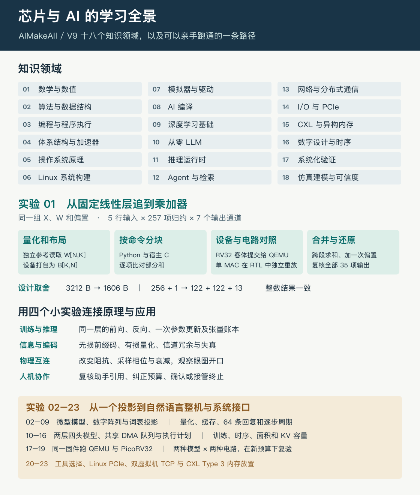

# AIMakeAll · 从数字 NPU 到模型推理

在自己的电脑上，用 SystemVerilog 设计一块 4×4 INT8 乘加阵列，从随机权重训练一个小型 Transformer，再用 RISC-V 固件把模型的前馈升维投影交给阵列。

**实验 02 · 同一层投影，从 1216 拍降到 960 拍。** 固定训练好的权重和前馈宽度 32，把激活与权重从分两拍读取改为同拍并行读取。处理同样 5 个提示符号，这一层少用 256 拍，整数输出逐项相同。[两种电路的实测对照](labs/02-trained-projection/README.md#第三步--读懂两次取舍)

**实验 03 · 同一份固件，两端都生成 `2 → 5 → 6 → EOS`。** 把实验 02 的模型编入 RV32 固件，分别在带教学 NPU 的 QEMU 和连接 RTL 阵列的 PicoRV32 上运行。两端各执行 40 条投影命令，256 个整数都与参考实现一致。[实测报告](labs/03-rv32-generation/verified-run.json) · [逐步串口记录](labs/03-rv32-generation/sample-0.uart)

[按本机环境选实验](#从一个乘加到一次生成) · [实验 04 整机成绩单](#实验-04-整机成绩单) · [实验 05 权重预打包](#实验-05-权重预打包) · [实验 06 连续切换模型](#实验-06-连续切换模型) · [个人学习目标](#个人学习目标) · [参考材料](#参考材料) · [知识覆盖图](#知识覆盖图) · [验证记录](docs/VALIDATION.md)

## 从一个乘加到一次生成

以下命令都在仓库根目录运行。基础环境只需 **Python 3.10+ 和 make**，表中列出每个入口额外用到的工具。

| 本机另需的工具 | 实验入口 | 运行后可以核对什么 |
| --- | --- | --- |
| 基础环境即可 | [00 · 手算一个乘加](labs/00-int8-matmul/README.md) · `make demo` | 输出矩阵左上角应为 **11**，即 `1 × 2 + (−2) × (−3) + 3 × 1` |
| 宿主 C 编译器 | [01 · 找到第 257 个乘积](labs/01-linear257/README.md) · `make linear` | 257 项拆为 256 + 1，合并部分和后，35 个整数与 Python 参考逐项一致 |
| Verilator、C++ 编译器 | [02 · 重放已训练模型的投影](labs/02-trained-projection/README.md) · `make projection-rtl` | 用仓库自带的张量复现 1216 拍和 960 拍，在波形里找到同一拍发出的两次读请求 |
| Verilator、C++ 编译器、CPU 版 PyTorch | [02 · 从随机权重重训](labs/02-trained-projection/README.md) · `make projection-train` | 在同一电路上把前馈宽度从 32 改为 24，比较留出集困惑度和投影周期 |
| 实验 02 的重训环境，加 RV32IM 裸机工具链和[项目版 QEMU 9.2.4](simulator/qemu-v0/README.md) | [03 · 用同一固件追踪生成](labs/03-rv32-generation/README.md) · `make generation` | 对照两端的投影整数和生成符号。默认样本首个整数为 **−18069**，首个生成符号为 **2** |
| 实验 02 的重训环境，加 RV32IM 裸机工具链 | [04 · 同一台 PicoRV32 的性能对照](labs/04-rv32-performance/README.md) · `make performance` | 分别核对提示词和每个生成步的纯 CPU / NPU 周期、数值和瓶颈 |
| 与实验 04 相同 | [05 · 权重现场打包与预打包](labs/05-weight-prepack/README.md) · `make prepack` | 在同一份固件上核对首次、重复请求和逐符号周期，计算额外 RAM 与回本次数 |
| 与实验 04 相同 | [06 · 同一固件切换模型](labs/06-model-switch/README.md) · `make model-switch` | 连续运行宽度 32 和 24 的模型，逐项核对尺度和输出，从总线验证坏包零命令 |

<strong>实验环境与常用检查</strong>

- **软件起步**　`make test` 运行 Python 回归，部分用例需要宿主 C 编译器。`make connections` 运行梯度核对、编码、链路与助手纠错练习。[实验 01 手册](labs/01-linear257/README.md)
- **仿真与综合**　有 Verilator 和 C++ 编译器时，可用 `make rtl-test` 核验实验 00 的单个乘加器。有 Yosys 时，`make projection-synth` 可综合实验 02 的两种局部存储配置。`make eda-doctor` 可盘点已有工具。[本地 EDA 环境](docs/LOCAL_EDA_ENVIRONMENT.md) · [重复工具的统一方案](docs/EDA_TOOLCHAIN_CONSOLIDATION.md)
- **设备与裸机生成**　构建带教学 NPU 的 QEMU 后，运行 `make device-test` 检查设备协议。实验 01 的两档预算对照用 `make design-trial`。实验 03 首次缺少检查点时会按实验 02 的配方重训，换一组提示符号用 `make generation GEN_SAMPLE=1`。[QEMU 构建说明](simulator/qemu-v0/README.md) · [实验 03 工具链与数学库要求](labs/03-rv32-generation/README.md#运行)
- **计时口径**　实验 03 将前馈升维投影交给设备，RV32 负责注意力、KV 缓存和符号选择。QEMU 核验设备行为和命令顺序，RTL 报告分别给出阵列周期和含软件浮点、轮询、串口诊断的整步周期。实验 04 用同一台 PicoRV32 的周期计数器做纯 CPU 对照，生成结束后统一输出日志。[仿真原则](docs/SIMULATION_FIRST.md) · [系统架构](docs/ARCHITECTURE.md)

## 实验 04 整机成绩单

同一个实验 03 检查点、同一份计时固件，只切换前馈升维投影的执行者。两种路径都将默认提示复述为 `2 → 5 → 6 → EOS`。

| 生成阶段 | 纯 CPU 周期 | CPU + NPU 周期 | 差异 |
| --- | ---: | ---: | --- |
| 处理 5 个提示符号，选出第一个符号 | 5,632,515 | 5,591,372 | 少 41,143 拍（0.73%） |
| 后续逐符号生成，三步合计 | 6,065,899 | 6,068,620 | 每步多 907 拍 |

提示词阶段，CPU 上的 Q/K/V 投影占 NPU 路径分段计时的 **45.73%**。逐符号时每步仍须打包 8 个块，生成 EOS 时 GELU 成为最大单项。另一组留出提示也复现了两阶段的收益方向。[逐步周期与瓶颈](labs/04-rv32-performance/README.md) · [实测报告](labs/04-rv32-performance/verified-sample-0.json)

**验收**要求四次运行各核对 256 个投影整数、44 个输出分数和 4 个生成符号，CPU 路径的设备命令为零。独立读者还需换一个留出提示，先预测、再用周期解释一项设计选择。试读任务已备好，待真人执行。[独立试读任务单](labs/04-rv32-performance/reader-task.md)

## 实验 05 权重预打包

把固定权重在 PicoRV32 上提前排好，只改软件布局。默认样本中，相对现场打包，首次完整请求从 **11,658,570 拍降到 11,609,807 拍**，已包含一次准备的 **14,381 拍**。同一模型驻留时，重复请求为 **11,595,403 拍**，每次节省 **63,167 拍（0.54%）**。

| 单符号生成，与各自固件的纯 CPU 相比 | 实验 04 现场打包 | 实验 05 现场打包 | 实验 05 预打包 |
| --- | ---: | ---: | ---: |
| 默认样本，后三步各自的周期差 | 慢 907 拍 | 慢 736 拍 | **快 11,891 拍** |

每路径每请求须核对 256 个整数、44 个输出分数和 4 个生成符号，分数相对独立参考的绝对误差须 ≤ 0.0001。另须用总线记录证实预打包缓冲在三个请求中分别写入 512、0、0 B。权重工作缓冲从 64 B 增至 512 B，净增 **448 B**；首次请求结束已净省 **48,763 拍**。另一组留出提示复现了同样的收益。[逐步成绩单、存储账本与验收](labs/05-weight-prepack/README.md) · [默认实测报告](labs/05-weight-prepack/verified-sample-0.json)

## 实验 06 连续切换模型

同一份 RV32 固件在 PicoRV32 与 4×4 RTL 阵列上按 **A → A → B → A** 连续生成。A 的前馈宽度为 32，B 为 24。第二次 A 换了地址仍命中缓存；切回 A 时，原来的单槽已被 B 使用，必须重新打包。

| 同一次启动 | 首次 A | 再次 A | 切至 B | 切回 A |
| --- | ---: | ---: | ---: | ---: |
| CPU 写入预打包缓存 | 512 B | **0 B** | 384 B | 512 B |
| NPU 投影命令 | 40 | 40 | 30 | 40 |
| 默认提示的首个投影整数 | −18,069 | −18,069 | −2,510 | −18,069 |

**验收**逐项检查了四个请求的 124 个量化尺度、960 个投影整数、176 个 logits 和 16 个生成符号。默认提示的 logits 最大绝对误差为 0.0000028611，低于 0.0001 门槛。四种坏包在各自请求内均为 **零设备命令、零寄存器写入、零 DMA、零缓存写入**。随后合法 A 仍能直接命中并生成。两个留出提示和空目录重建均已通过。[实验步骤与验收](labs/06-model-switch/README.md) · [默认样本](labs/06-model-switch/verified-sample-0.json) · [迁移样本](labs/06-model-switch/verified-sample-1.json)

## 个人学习目标

**给你一个新的输入形状，或把可用缓冲空间减半，你能独立决定该改电路、模型还是推理程序，并用实验解释为什么。** 先预测影响，再固定模型比较电路、固定电路比较模型。用波形找出阵列在哪一拍等待数据，用生成记录定位第一个有偏差的输出。最后用同一批输入比较模型质量和投影周期，写下选择理由，再换一组输入复验。[个人毕业任务](docs/CHIP_MODEL_PLAN.md#个人毕业任务) · [芯模联合实验](docs/PROJECT_MAP.md#芯模联动的实验与验收)

## 参考材料

### 主线教材与开源实现

| 资料 | 什么时候读 | AIMakeAll 学习入口 |
| --- | --- | --- |
| [《深入理解计算机系统》· CS:APP 第三版](https://csapp.cs.cmu.edu/3e/) | 第一次在 C、汇编、地址和字节之间追踪同一块数据时 | [12 章系统基础](docs/CSAPP_FOUNDATIONS.md) |
| [MIT 6.006 · Introduction to Algorithms](https://ocw.mit.edu/courses/6-006-introduction-to-algorithms-spring-2020/) | 需要为依赖图选择执行顺序、估算分块或调度的复杂度时 | [算法与数据结构](docs/ALGORITHMS_FOUNDATIONS.md) |
| [Operating Systems: Three Easy Pieces · OSTEP](https://pages.cs.wisc.edu/~remzi/OSTEP/) | 需要解释地址空间、并发、设备所有权和持久状态时 | [操作系统原理](docs/OSTEP_FOUNDATIONS.md) |
| [Linux From Scratch · 13.1-systemd](https://www.linuxfromscratch.org/lfs/view/13.1-systemd/) | 从裸机路线扩展到 Linux，开始构建工具链和根文件系统时 | [LFS 章节与阶段](docs/LFS_FOUNDATIONS.md) |
| [Understanding Deep Learning · Simon J. D. Prince](https://udlbook.github.io/udlbook/) | 需要推导损失、梯度、优化，或解释模型的泛化与量化误差时 | [21 章与数学附录](docs/UDL_FOUNDATIONS.md) |
| [Build a Large Language Model (From Scratch) · Sebastian Raschka](https://www.manning.com/books/build-a-large-language-model-from-scratch) | 自己写注意力、组装 GPT、训练和生成时 | [七章与附录的项目映射](models/README.md) |
| [MiniMind · jingyaogong/minimind](https://github.com/jingyaogong/minimind) | 已能训练小模型，准备对照完整工程的数据、训练、推理和工具调用时 | [源码导读与 NPU 接入方案](docs/MINIMIND_INTEGRATION.md) |

实验 02、03 使用 AIMakeAll 自己训练的符号模型。MiniMind 和下列框架提供工程对照，字节语料 LLM、模型驱动的 Agent 属于后续阶段。[模型实现](models/tiny_copy.py) · [课程状态总表](docs/CURRICULUM.md#课程状态总表)

### 按问题查原始资料

<strong>数字电路与芯片设计</strong>　乘加结构、开源 CPU、验证、物理实现

- **从器件到算术电路**　先看 MOS 器件与门，再推导乘法器、流水线和时钟约束。[MIT 6.002 电路与电子学](https://ocw.mit.edu/courses/6-002-circuits-and-electronics-spring-2007/) · [6.012 微电子器件与电路](https://ocw.mit.edu/courses/6-012-microelectronic-devices-and-circuits-fall-2009/) · [6.004 算术结构与设计取舍](https://ocw.mit.edu/courses/6-004-computation-structures-spring-2017/pages/c8/c8s1/) · [6.374 数字集成电路](https://ocw.mit.edu/courses/6-374-analysis-and-design-of-digital-integrated-circuits-fall-2003/) · [ngspice 手册](https://ngspice.sourceforge.io/docs.html)
- **处理器与加速器**　实验 03 使用固定版本的 PicoRV32。Ibex 是后续集成路线，Gemmini 用来对照加速器、系统软件和 SoC 的协同设计。[RV32I 指令集](https://docs.riscv.org/reference/isa/unpriv/rv32.html) · [PicoRV32 固定提交](https://github.com/YosysHQ/picorv32/tree/ef203c2b0a3fb793280f5114941416c425c5b461) · [Ibex](https://github.com/lowRISC/ibex) · [Gemmini 源码](https://github.com/ucb-bar/gemmini) · [Gemmini 原论文](https://slice.eecs.berkeley.edu/papers/gemmini-enabling-systematic-deep-learning-architecture-evaluation-via-full-stack-integration/) · [MIT 6.823 体系结构](https://ocw.mit.edu/courses/6-823-computer-system-architecture-fall-2005/)及[教学大纲](https://ocw.mit.edu/courses/6-823-computer-system-architecture-fall-2005/pages/syllabus/) · [NVIDIA SIMT 执行模型](https://docs.nvidia.com/cuda/cuda-programming-guide/03-advanced/advanced-kernel-programming.html)
- **RTL 仿真与综合**　从波形里的握手信号追到综合后的逻辑单元。[Verilator 使用指南](https://verilator.org/guide/latest/overview.html)与[源码](https://github.com/verilator/verilator) · [Yosys 入门](https://yosyshq.readthedocs.io/projects/yosys/en/latest/introduction.html)、[完整手册](https://yosyshq.readthedocs.io/projects/yosys/en/latest/)与[源码](https://github.com/YosysHQ/yosys) · [cocotb 支持的仿真器](https://docs.cocotb.org/en/stable/simulator_support.html)
- **验证与数据完整性**　为溢出、复位和数据损坏建立独立参考与检查。[OpenTitan 验证方法](https://opentitan.org/book/doc/contributing/dv/methodology/index.html) · [SBY 的 FIFO 形式验证示例](https://yosyshq.readthedocs.io/projects/sby/en/latest/quickstart.html) · [OpenTitan ECC 生成工具](https://opentitan.org/book/util/design/index.html#ecc-generator-tool) · [OTBN 数据完整性设计](https://opentitan.org/book/hw/ip/otbn/doc/theory_of_operation.html#data-integrity-protection)
- **时序、物理实现与功耗**　了解综合、静态时序、布线和 PDK 各提供什么证据。[OpenSTA](https://github.com/parallaxsw/OpenSTA)及[VCD 功耗示例](https://openroad.readthedocs.io/en/latest/main/src/sta/doc/Examples.html#power-analysis) · [OpenROAD](https://openroad.readthedocs.io/en/latest/main/README.html) · [LibreLane 安装](https://librelane.readthedocs.io/en/stable/installation/index.html)及[手动配置](https://librelane.readthedocs.io/en/latest/installation/manual_installation/index.html) · [SKY130 PDK](https://skywater-pdk.readthedocs.io/en/main/)及[项目状态](https://skywater-pdk.readthedocs.io/en/main/status.html) · [本地环境清单](docs/LOCAL_EDA_ENVIRONMENT.md)
- **版图、网表与存储宏**　用 Magic 或 KLayout 查看版图，用 Netgen 核对版图提取的网表与原理图，再看 OpenRAM 如何生成 SRAM 宏。[Magic](https://github.com/RTimothyEdwards/magic) · [KLayout](https://www.klayout.de/) · [Netgen](https://github.com/RTimothyEdwards/netgen) · [OpenRAM](https://github.com/VLSIDA/OpenRAM)
- **芯片生命周期**　读懂上电、复位和可信启动的先后关系。[OpenTitan 电源管理](https://opentitan.org/book/hw/top_earlgrey/ip_autogen/pwrmgr/doc/theory_of_operation.html) · [安全启动设计](https://opentitan.org/book/doc/security/specs/secure_boot/)

**项目内对应课程**　[数字设计与时序](docs/DIGITAL_DESIGN_TIMING.md) · [算术电路](docs/DIGITAL_DESIGN_TIMING.md#dd01dd02dd07-深化计算机算术与算术电路结构) · [系统化验证](docs/SYSTEMATIC_VERIFICATION.md) · [硬件数据完整性](docs/ARCHITECTURE.md#领域-04-与-17-深化硬件数据完整性与故障处置)

<strong>模型研发与 AI</strong>　教材配套代码、训练、评测、经典 AI 与 Agent

- **Understanding Deep Learning**　从一章的推导回到对应 notebook，再检查实验假设。[MIT Press 书目](https://mitpress.mit.edu/9780262048644/understanding-deep-learning/) · [官方目录 PDF](https://mitp-content-server.mit.edu/books/content/sectbyfn/books_pres_0/15055/prince_toc_.pdf) · [配套 notebooks](https://github.com/udlbook/udlbook) · [资源许可](https://github.com/udlbook/udlbook/blob/main/LICENSE)
- **从零实现 LLM**　按模型定义、预训练、指令微调的顺序对照代码。[作者书页](https://sebastianraschka.com/llms-from-scratch/) · [配套仓库](https://github.com/rasbt/LLMs-from-scratch) · [第 4 章 GPT 实现](https://github.com/rasbt/LLMs-from-scratch/blob/main/ch04/01_main-chapter-code/gpt.py) · [第 5 章训练](https://github.com/rasbt/LLMs-from-scratch/blob/main/ch05/README.md) · [第 7 章微调](https://github.com/rasbt/LLMs-from-scratch/blob/main/ch07/README.md) · [代码许可与书稿范围](https://github.com/rasbt/LLMs-from-scratch/blob/main/LICENSE.txt)
- **MiniMind 的数据与训练**　沿固定快照从词表读到模型权重。[数据说明](https://github.com/jingyaogong/minimind/blob/233d00fa068ec2b8c0d4f07b703934d6391a5a73/dataset/dataset.md) · [分词器训练](https://github.com/jingyaogong/minimind/blob/233d00fa068ec2b8c0d4f07b703934d6391a5a73/trainer/train_tokenizer.py) · [分词器配置](https://github.com/jingyaogong/minimind/blob/233d00fa068ec2b8c0d4f07b703934d6391a5a73/model/tokenizer_config.json) · [数据管线](https://github.com/jingyaogong/minimind/blob/233d00fa068ec2b8c0d4f07b703934d6391a5a73/dataset/lm_dataset.py) · [模型](https://github.com/jingyaogong/minimind/blob/233d00fa068ec2b8c0d4f07b703934d6391a5a73/model/model_minimind.py) · [预训练](https://github.com/jingyaogong/minimind/blob/233d00fa068ec2b8c0d4f07b703934d6391a5a73/trainer/train_pretrain.py) · [指令微调](https://github.com/jingyaogong/minimind/blob/233d00fa068ec2b8c0d4f07b703934d6391a5a73/trainer/train_full_sft.py) · [训练工具](https://github.com/jingyaogong/minimind/blob/233d00fa068ec2b8c0d4f07b703934d6391a5a73/trainer/trainer_utils.py)
- **MiniMind 的推理与工具调用**　追踪一次生成如何进入服务、训练循环与工具评测。[模型转换](https://github.com/jingyaogong/minimind/blob/233d00fa068ec2b8c0d4f07b703934d6391a5a73/scripts/convert_model.py) · [推理服务](https://github.com/jingyaogong/minimind/blob/233d00fa068ec2b8c0d4f07b703934d6391a5a73/scripts/serve_openai_api.py) · [轨迹采样](https://github.com/jingyaogong/minimind/blob/233d00fa068ec2b8c0d4f07b703934d6391a5a73/trainer/rollout_engine.py) · [Agent 训练](https://github.com/jingyaogong/minimind/blob/233d00fa068ec2b8c0d4f07b703934d6391a5a73/trainer/train_agent.py) · [工具调用评测](https://github.com/jingyaogong/minimind/blob/233d00fa068ec2b8c0d4f07b703934d6391a5a73/scripts/eval_toolcall.py) · [固定版本说明](https://github.com/jingyaogong/minimind/blob/233d00fa068ec2b8c0d4f07b703934d6391a5a73/README.md) · [上游依赖](https://github.com/jingyaogong/minimind/blob/233d00fa068ec2b8c0d4f07b703934d6391a5a73/requirements.txt) · [上游许可](https://github.com/jingyaogong/minimind/blob/233d00fa068ec2b8c0d4f07b703934d6391a5a73/LICENSE) · [快照与各文件 SHA-256](models/minimind/source-lock.json)
- **训练实现与精度**　从自动求导，读到混合精度的数值取舍和多设备通信。[PyTorch](https://github.com/pytorch/pytorch) · [llm.c](https://github.com/karpathy/llm.c) · [Mixed Precision Training 原论文](https://arxiv.org/abs/1710.03740) · [PyTorch 分布式教程](https://docs.pytorch.org/tutorials/distributed.html)
- **经典 AI 与学习评估**　为神经网络选择简单基线，检查分类概率、聚类和规划结果。[Berkeley CS188 教材](https://inst.eecs.berkeley.edu/~cs188/textbook/) · [Artificial Intelligence: A Modern Approach](https://aima.cs.berkeley.edu/) · [scikit-learn 监督学习](https://scikit-learn.org/stable/supervised_learning.html)、[聚类](https://scikit-learn.org/stable/modules/clustering.html)与[概率校准](https://scikit-learn.org/stable/modules/calibration.html)
- **多模态、因果与控制**　从图文配对进入表示学习，从状态估计进入控制。因果课程解释怎样区分观察与干预。[CLIP 原论文](https://proceedings.mlr.press/v139/radford21a.html) · [Brady Neal 因果推断课程](https://www.bradyneal.com/causal-inference-course) · [MIT Underactuated Robotics](https://underactuated.mit.edu/) · [MIT 6.003 信号与系统](https://ocw.mit.edu/courses/6-003-signals-and-systems-fall-2011/)
- **检索与 Agent**　分别评价检索排序、模型选取的动作和任务结果。[Stanford 信息检索教材 · 排序评价](https://nlp.stanford.edu/IR-book/html/htmledition/evaluation-of-ranked-retrieval-results-1.html) · [ReAct 原论文](https://arxiv.org/abs/2210.03629) · [本项目 Agent 课程](agents/README.md)

<strong>推理部署与系统软件</strong>　裸机固件、QEMU、编译器、性能与操作系统

- **跑通实验 03**　用裸机工具链编出 RV32IM 固件，观察 QEMU 上的内存映射设备和 RTL 上的同一条命令。[RISC-V GNU 工具链](https://github.com/riscv-collab/riscv-gnu-toolchain) · [Newlib](https://sourceware.org/newlib/) · [QEMU RISC-V 系统模型](https://www.qemu.org/docs/master/system/target-riscv.html)及[virt 平台](https://www.qemu.org/docs/master/system/riscv/virt.html) · [QEMU 发布目录](https://download.qemu.org/)与[9.2.4 源码包](https://download.qemu.org/qemu-9.2.4.tar.xz) · [项目设备 ABI](specs/npu-v0.md)
- **AI 编译与性能**　从表示算子和数值精度，走到缓冲区、向量化与测量范围。[MLIR Toy 教程](https://mlir.llvm.org/docs/Tutorials/Toy/) · [量化](https://mlir.llvm.org/docs/Quantization/) · [Bufferization](https://mlir.llvm.org/docs/Bufferization/) · [LLVM 向量化](https://llvm.org/docs/Vectorizers.html) · [MIT 6.172 性能工程](https://ocw.mit.edu/courses/6-172-performance-engineering-of-software-systems-fall-2018/) · [MLPerf Inference 测量规则](https://github.com/mlcommons/inference_policies/blob/master/inference_rules.adoc)
- **系统、算法与正确性**　按需回查数据表示、内存错误、实时调度和持久化。[CS:APP 出版社书目](https://www.pearson.com/en-us/pearsonplus/p/9780138105396)、[前言](https://csapp.cs.cmu.edu/3e/pieces/preface3e.pdf)、[学生资源](https://csapp.cs.cmu.edu/3e/students.html)与[官方 Labs](https://csapp.cs.cmu.edu/3e/labs.html) · [MIT 6.006 课程安排](https://ocw.mit.edu/courses/6-006-introduction-to-algorithms-spring-2020/pages/calendar/) · [MIT 6.045J 可计算性与复杂性](https://ocw.mit.edu/courses/6-045j-automata-computability-and-complexity-spring-2011/) · [CMU 实时系统分析讲义](https://www.cs.cmu.edu/~aldrich/courses/654-sp07/slides/23-realtime.pdf) · [AddressSanitizer](https://clang.llvm.org/docs/AddressSanitizer.html) · [UndefinedBehaviorSanitizer](https://clang.llvm.org/docs/UndefinedBehaviorSanitizer.html) · [SQLite 原子提交](https://www.sqlite.org/atomiccommit.html)与[隔离](https://www.sqlite.org/isolation.html)
- **构建 Linux**　先检查宿主和目标架构，再追踪各阶段工具链。[LFS 项目](https://www.linuxfromscratch.org/lfs/) · [宿主要求](https://www.linuxfromscratch.org/lfs/view/13.1-systemd/chapter02/hostreqs.html) · [架构说明](https://www.linuxfromscratch.org/lfs/view/13.1-systemd/prologue/architecture.html) · [工具链说明](https://www.linuxfromscratch.org/lfs/view/13.1-systemd/partintro/toolchaintechnotes.html) · [本版勘误](https://www.linuxfromscratch.org/lfs/view/13.1-systemd/prologue/errata.html) · [Beyond Linux From Scratch](https://www.linuxfromscratch.org/blfs/) · [法律声明](https://www.linuxfromscratch.org/lfs/view/stable-systemd/legalnotice.html)、[文字许可](https://www.linuxfromscratch.org/lfs/view/stable-systemd/appendices/creat-comm.html)与[指令许可](https://www.linuxfromscratch.org/lfs/view/stable-systemd/appendices/mit.html)

**项目内对应课程**　[AI 编译](docs/AI_COMPILATION.md) · [工程专项](docs/ENGINEERING_BRIDGES.md) · [仿真建模与可信度](docs/SIMULATION_CREDIBILITY.md) · [资源预算与共同交付](docs/ROADMAP.md#四项共同交付的阶段安排)

<strong>存储、网络与互连</strong>　缓存与片上网络、PCIe、CXL 及协议仿真

- **体系结构与存储建模**　追踪一次请求经过事件队列、缓存一致性协议和片上网络的过程。[gem5 事件教程](https://www.gem5.org/documentation/learning_gem5/part2/events/) · [存储系统教程](https://www.gem5.org/assets/files/ASPLOS2017_gem5_tutorial.pdf) · [MSI 一致性协议](https://www.gem5.org/documentation/learning_gem5/part3/cache-intro/) · [Garnet 片上网络](https://www.gem5.org/documentation/general_docs/ruby/garnet-2/)
- **网络与分布式通信**　从虚拟网卡、TCP 和 HTTP 进入多节点推理服务，再看 RDMA 的软件接口。[QEMU 网络设备](https://www.qemu.org/docs/master/system/devices/net.html) · [RFC 9293 · TCP](https://www.rfc-editor.org/rfc/rfc9293.html) · [RFC 9110 · HTTP Semantics](https://www.rfc-editor.org/rfc/rfc9110.html) · [rdma-core](https://github.com/linux-rdma/rdma-core) · [cocotbext-eth](https://github.com/alexforencich/cocotbext-eth)
- **PCIe、DMA 与中断**　从寄存器窗口走到设备驱动、总线事务和内存所有权。[QEMU EDU 设备](https://www.qemu.org/docs/master/specs/edu.html) · [Linux PCI 驱动](https://docs.kernel.org/PCI/pci.html) · [DMA 指南](https://docs.kernel.org/core-api/dma-api-howto.html) · [MSI 中断指南](https://docs.kernel.org/PCI/msi-howto.html) · [cocotbext-pcie](https://github.com/alexforencich/cocotbext-pcie)
- **CXL 与异构内存**　对照模拟器里的 Type 3 内存设备与内核中的 CXL 对象。[QEMU CXL 模型](https://www.qemu.org/docs/master/system/devices/cxl.html) · [Linux CXL 文档](https://docs.kernel.org/driver-api/cxl/index.html)

**项目内对应课程**　[网络](docs/NETWORKING_FOUNDATIONS.md) · [I/O 与 PCIe](docs/PCIE_IO_FOUNDATIONS.md) · [CXL 与异构内存](docs/CXL_MEMORY_FOUNDATIONS.md)

## 知识覆盖图

图中的十八个领域可以按问题查阅。自然语言模型、更大范围的算子部署、模型驱动的 Agent 各有后续验收。[里程碑](docs/ROADMAP.md)

按计划推进时，可以查看十组深化实验、十条补全路线和六项跨层补强各自的交付物与验收条件。[课程目录](docs/CURRICULUM.md) · [全景规划](docs/PROJECT_MAP.md) · [十条补全路线](docs/CHIP_AI_COMPLETENESS.md) · [六项跨层补强](docs/CHIP_AI_COMPLETENESS.md#六项跨层补强)

想练习如何从需求反推设计，可以从实时系统、多模态或因果专题选择一个约束，带入综合实验比较候选方案。[三门专题](docs/CHIP_AI_COMPLETENESS.md#实时-多模态与因果课程) · [从需求出发的整体设计取舍](docs/CHIP_AI_COMPLETENESS.md#design-从需求出发的整体设计取舍)

## 目录与许可

| 在仓库里找什么 | 入口 |
| --- | --- |
| 课程、实验与证据 | [GitHub 仓库](https://github.com/friendmine/AIMakeAll) · [规划文档](docs/) · [实验手册](labs/) · [验证记录](docs/VALIDATION.md) · [早期 CI 运行记录](https://github.com/friendmine/AIMakeAll/actions/runs/44074780583) |
| 电路、模型与运行时 | [数字 RTL](hardware/rtl/) · [模型实现](models/) · [仿真设备](simulator/) · [运行时与驱动](runtime/) · [Agent](agents/) |
| 规范、参考与工具 | [接口规范](specs/) · [数学参考](reference/) · [回归测试](tests/) · [EDA 环境盘点](tools/eda/) |

本仓库原创教材和一般代码采用 MIT 许可。PicoRV32 核保留 ISC 许可，QEMU 教学设备、头文件与集成补丁采用 GPL-2.0-or-later。外部教材、课件、代码、数据和权重分别遵循各自的许可。[MIT](LICENSE) · [PicoRV32 许可](hardware/ip/picorv32/COPYING) · [QEMU 设备许可](simulator/qemu-v0/COPYING) · [来源与引入规则](docs/OPEN_SOURCE.md) · [贡献约定](CONTRIBUTING.md)
