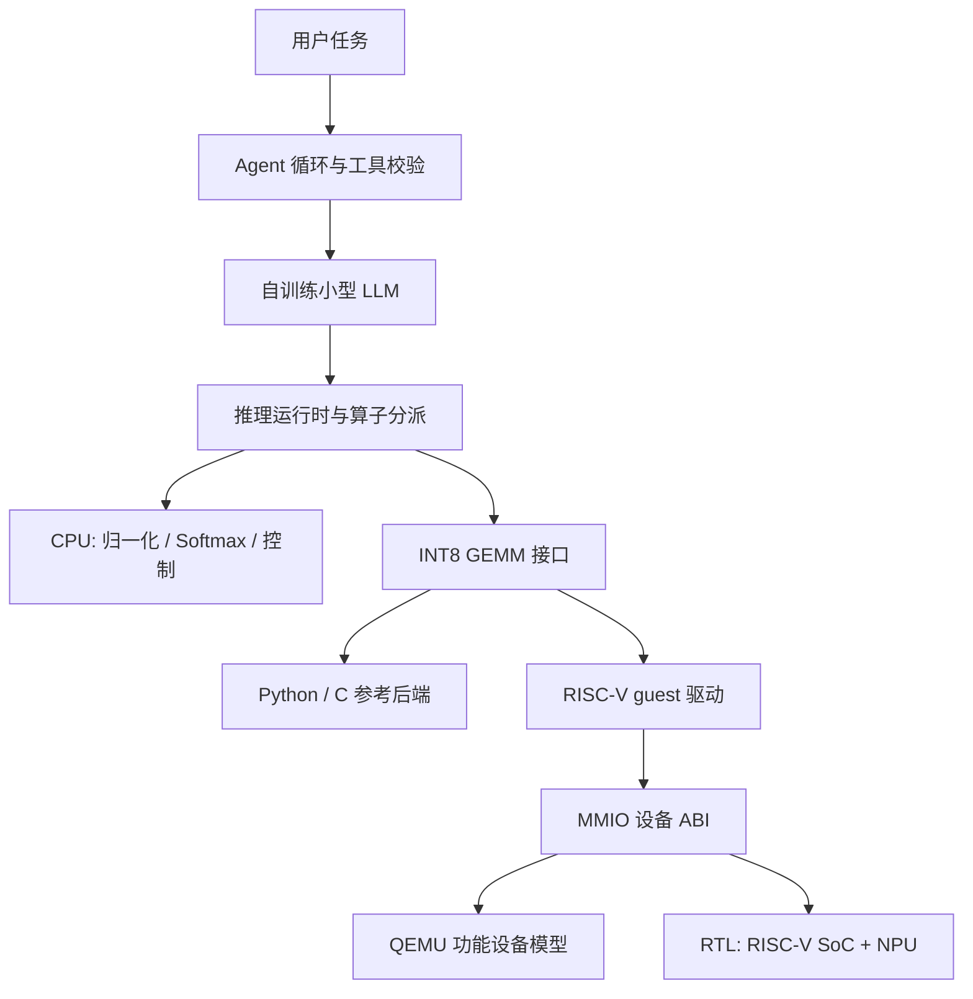
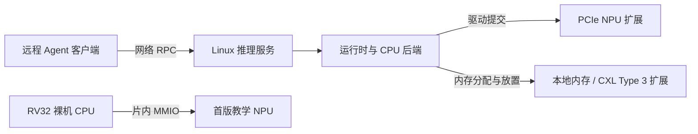

# 系统架构与技术选择

总体学习依赖见 [全景规划图](PROJECT_MAP.md)。CSAPP 的信息表示、处理器、存储、链接、异常、I/O 与并发组成跨层基础，详细映射见 [CSAPP 模块](CSAPP_FOUNDATIONS.md)。书中的 x86-64/Y86-64 教学示例与本项目 RISC-V 目标分别维护，不共享未经适配的二进制与 ABI 假设。

体系结构广度增加 [HET CPU/GPU/DSP 对照与 CHIP 产品流程](CHIP_AI_COMPLETENESS.md)，从执行模型、数据流进入物理/供电/测试认知。实验采用教学模型、RTL 或开放物理流程，尚待实施，不改变本页首版 RISC-V/NPU 选择。

## 端到端数据流

模型与学习方法由 [Understanding Deep Learning 基础](UDL_FOUNDATIONS.md) 支撑，连接损失、梯度、Transformer 与质量评估。训练保留在宿主机，首版 NPU 加速推理线性层；量化和设备接入是本项目独立的工程实验。

### 模型转换与运行时边界

[AI 编译路线](AI_COMPILATION.md) 增加有限计算图检查 → 布局/量化 → GEMM 分块 → 缓冲区规划 → 执行计划。编译器决定静态计划，运行时绑定内存并处理动态输入，驱动执行设备协议。首版采用小型自写转换器，MLIR 为后续进阶；尚未实现通用模型导出。

[算法](ALGORITHMS_FOUNDATIONS.md) 支撑图排序、索引和调度；[OSTEP](OSTEP_FOUNDATIONS.md) 支撑内存生命周期、同步和持久状态。所有新连接层目前属于设计。计划必须遵守 NPU v0 每次清零、最大维度 256、32 位地址与同步轮询等约束；K 分块部分和由运行时合并，CPU 承担 scale/bias 和其他回退。

[工程专项](ENGINEERING_BRIDGES.md) 统一数值、数据、性能和检索验收。性能模型、硬件仿真周期和宿主墙钟时间分开记录，不用理论峰值代替实测。

### 推理时的数据流

这是目标架构，目前只有 Python GEMM 和独立 MAC RTL 实验落地。QEMU 与 RTL 是两种执行环境，共享算子语义和驱动协议；QEMU 不会自动执行 Verilog，也不会自动拥有自定义 NPU。

已有独立芯片实验环境现已作为项目的外部基础设施登记，详见 [本地 EDA 依赖与接入分析](LOCAL_EDA_ENVIRONMENT.md)。这些工具和历史案例尚未组成 AIMakeAll 的 SoC；两套 PDK、不同仿真器版本及 SRAM 交付物必须分别管理。

## 首版选择

全项目遵循 [仿真优先原则](SIMULATION_FIRST.md)：数字模块以参考模型 → RTL 仿真 → 逻辑综合交付，物理设计可选；QEMU/Linux 验证驱动和应用。网络、PCIe、CXL 分别配置协议/事务模型，PHY 与实板不是核心依赖。QEMU 功能模型、可综合 RTL、测试台和完整标准合规须分别标明。

| 层 | 默认路线 | 原因与边界 |
| --- | --- | --- |
| RISC-V CPU | Ibex RV32IMC，裸机 | CPU 已开源；教学重点放在系统集成。不是 Linux 平台 |
| 教学 NPU | 自实现 SystemVerilog INT8 MAC → 4×4 阵列 | 算术、数据流和带宽可逐层解释 |
| 硬件验证 | Verilator；后续增加 Yosys 综合 | 软件仿真无需购买板卡；器件适配另做评估 |
| 软件模拟 | QEMU RISC-V 系统模拟 + 自定义 MMIO 设备 | 固定板级映射，尽量复用裸机驱动 |
| 模型训练 | 自写模型结构，PyTorch 自动求导，CPU 起步 | 不需要闭源服务；GPU 加速是可选项 |
| 部署 | C 标量后端 → guest NPU 后端 | 先保证数值一致，再优化 |
| Agent | 简单显式状态机 + JSON 工具协议 | 避免框架掩盖模型、工具与运行时之间的边界 |

Ibex 是面向嵌入式控制的开源 32 位 RISC-V 核，见 [上游项目](https://github.com/lowRISC/ibex)。未来如需 Linux，需另选具有合适特权级、MMU 等支持的 CPU/SoC，并单独维护 RV64 配置。

Gemmini 作为后续对照学习材料：它属于 Chipyard/Chisel 生态，其集成方式和指令接口与本项目 MMIO 路线不同，不能直接当作 Ibex 外设插入。见 [Gemmini 上游](https://github.com/ucb-bar/gemmini)。

## Linux 系统构建扩展

[Linux From Scratch](LFS_FOUNDATIONS.md) 补充工具链自举、用户态、内核与启动知识。基础复现采用独立 Linux x86-64 环境；RV64 Linux/QEMU 为后续适配线，单独配置固件、设备树、内核、rootfs 和 Linux NPU 驱动。初期裸机固件与 Linux 用户进程分别构建，共享数值规范，不共享未经适配的二进制和设备访问代码。

Linux 路线中由内核驱动管理设备资源与缓冲区，用户态 C 运行时通过明确接口提交计算。模型训练留在宿主环境；guest 的推理与工具服务独立验收启动、权限、日志、停止和重启。目前尚无 LFS 镜像或 Linux 驱动实现。

## 互连、通信与内存扩展

新增 [网络](NETWORKING_FOUNDATIONS.md)、[I/O 与 PCIe](PCIE_IO_FOUNDATIONS.md)、[CXL](CXL_MEMORY_FOUNDATIONS.md) 三条课程，全部待实现。互连负责连接不同层次，不能把三者视为线性的接口替换。

上图为目标连接关系，CXL 与 PCIe NPU 尚未集成在同一验证平台。首个 CXL 实验用独立 x86-64 q35 guest，RV64 迁移另验；不直接扩大首版裸机 NPU 的能力。

- **设备路径**：保留 GEMM 数值语义，新增独立 PCIe 传输 ABI。Linux 驱动管理 BAR、DMA 映射、中断与资源生命周期，用户态提交缓冲区句柄；不复用裸机地址假设。
- **网络路径**：协议传输经过校验的输入与结果，不传可解引用地址。先 CPU 服务，再接真实 NPU 后端；超时、取消、重试及背压贯穿 Agent 与服务端。
- **内存路径**：CXL 初期解决可访问容量与放置问题。NPU v0 只有 32 位地址，访问扩展内存需额外证明映射能力或使用暂存搬运；编译器的放置提示由运行时兑现。

按 [S0–S3](ROADMAP.md) 分阶段验收，网络可并行。QEMU 的功能结果、网络服务墙钟、参数化带宽/延迟估算、真实 PCIe/CXL/RDMA 性能分别报告。

## QEMU 的职责

新增的 [DD](DIGITAL_DESIGN_TIMING.md)、[DV](SYSTEMATIC_VERIFICATION.md)、[SIM](SIMULATION_CREDIBILITY.md) 在接口边界协同：DD 定义采样/复位/握手，DV 按需求验证实现，SIM 规定时间推进、事件顺序与模型适用性。功能参考只比较承诺的事务结果，周期模型与 RTL 才在共同采样规则下比较周期；QEMU/RTL 首先做离线对照。共享 FIFO 为独立教学实验，不更改现有 MAC 复位或 NPU v0 协议。

QEMU 支持 32/64 位 RISC-V 系统模拟，但机器模型决定设备与内存映射；`virt` 并非某个真实硬件 SoC 的复制品。见 [QEMU 官方说明](https://www.qemu.org/docs/master/system/target-riscv.html)。

本项目计划先建立可运行软件的虚拟平台，不宣称它精确复现 Ibex 的流水线、缓存或周期。裸机代码的 ISA、链接地址、UART 和 NPU 地址必须与所选机器一致。Linux + RV64 `virt` 属于后续扩展，不能复用 RV32 裸机映像直接启动。

## 如何证明加速

同一模型、同一输入、同一量化精度下分别测量：

1. 宿主机原生 CPU 推理：作为现实使用基线。
2. QEMU guest 的 CPU 标量推理：衡量模拟环境内的软件路径。
3. QEMU guest + NPU 设备后端：衡量设备卸载与宿主机实现带来的变化。
4. RTL/未来 FPGA：记录真实周期或板卡耗时；RTL 仿真的墙钟速度不等于硬件速度。

每项记录预热次数、重复次数、输入形状、线程数、构建选项、中位数与 P95。模型推理分别记录 prefill tokens/s、decode tokens/s、峰值内存与搬运字节数。Agent 另报总任务耗时和任务成功率。

矩阵核心快不等于整个模型快。例如可加速部分占总耗时 70%、该部分快 10 倍时，理想总加速比仅为 `1 / (0.30 + 0.70 / 10) ≈ 2.70`，且还没计入额外搬运开销。

## 内存与模型规模

首版 RV32 采用小模型和短上下文。实际 SRAM/RAM 容量在 SoC 集成前确定，权重、激活、KV cache 与代码必须有显式预算。训练不在教学 NPU 上执行；第一阶段 NPU 仅承担推理的整数矩阵乘法。扩展训练算子需要新的精度、梯度和存储设计。

## 领域 04 深化：体系结构与存储系统实验

以下 ARCH-E1–E6 是既有领域 04 内的原创实验编号，连接领域 05/08/11/14/15，不新增一级知识领域或独立必修主线。全部待实现；先做软件/周期模型，再按需求映射到 RTL，不依赖板卡。方法复用 DD/DV/SIM 与 ENG03。

| 子实验 | 知识与前置 | 实验产物 | 验收要求 |
| --- | --- | --- | --- |
| ARCH-E1 数据流与复用 | GEMM、AL01、AC07；循环次序、分块、权重/输入/部分和驻留 | 固定小矩阵，比较朴素与至少两种分块/数据流，输出访问轨迹和每层读写字节账本 | 结果逐元素一致；区分真实访问与模型估算，计入尾块、打包与部分和；不假设 v0 支持旧 C 累加 |
| ARCH-E2 局部存储与 bank | DD03/DD08；端口数、bank 映射、冲突、仲裁、容量预算 | 在相同阵列/数据流下扫描局部存储容量与 bank 数，先周期模型后可选 RTL | 明确每 bank 端口和周期能力；冲突时停顿而非丢数据；报告周期、利用率和容量，不只比较 MAC 数量 |
| ARCH-E3 Cache 与 scratchpad | CS06、OS03/OS04；行/组/替换/写策略、TLB 与 Cache 区别 | 地址轨迹驱动的小 Cache 模拟器，对比显式分块局部存储；增加 stride/工作集用例 | 手算轨迹可核对 hit/miss/写回；声明冷启动与策略；缓存行不是页，CPU Cache 不是模型 KV Cache |
| ARCH-E4 共享内存与可见性 | OS05/OS07、IO03；内存顺序、原子性、缓存维护、DMA 地址与屏障 | 教学模型模拟 CPU 缓存和设备访问，制造旧输入/旧输出；另在具备条件的 Linux guest 验证 DMA API 路径 | 区分 cache coherence、内存顺序与软件同步；屏障不自动清理非一致缓存，volatile 不代替同步；未建模/未跑平台单列 |
| ARCH-E5 一致性状态模型 | ARCH-E3/E4、DV03/DV05；MSI 状态、失效确认、权限与数据版本 | 两个缓存与目录的有限状态模型，枚举读写/失效/确认交错，再注入确认丢失 | 检查单写者/多读者、最新值与无非法权限；活性需公平性/响应假设；MSI 教学通过不代表 CXL 合规或已实现多核 |
| ARCH-E6 设计空间与存储分层 | SIM05–SIM07、ENG03；算术强度、带宽/计算上界、容量与放置 | 固定精度/负载，扫描阵列规模、bank/缓冲区、带宽/延迟；后续接权重/KV 的 NUMA/CXL 放置 | 参数有来源，留出校验用例；理论上界与实测/仿真分栏，计入打包/搬运/回退；单次结果不推成普遍最优 |

首组先做 ARCH-E1：固定原始输入、数值语义与有效工作量，只改变循环/分块。记录主存↔局部存储↔阵列各边界的字节与访问次数；计数规则明确读写、重读、padding 是否计入。ARCH-E2 再在同一负载下改变存储约束，避免同时改变模型、量化或硬件规模导致比较失真。

ARCH-E3–E5 为独立模拟练习，不把 Cache、原子指令、多核或一致性支持隐含加入 Ibex/NPU v0。首版仍按无 coherence 保证、同步轮询及 32 位设备地址推进。ARCH-E6 的重叠收益仅在模型/实现确有双缓冲和异步机制时评估；缓存/一致性模型不是首个 G2 闭环的前置条件。

理论范围参考 [MIT 6.823 体系结构课程](https://ocw.mit.edu/courses/6-823-computer-system-architecture-fall-2005/pages/syllabus/)，MSI 模型参考 [gem5 教程](https://www.gem5.org/documentation/learning_gem5/part3/cache-intro/)，Linux DMA 边界参考 [内核指南](https://docs.kernel.org/core-api/dma-api-howto.html)。仅组织原创实验与来源，不复制整套课程或引入大型模拟器为必需依赖。

## 领域 04 深化：存储控制器与片上互连

MEM-E1–E6 细化 ARCH-E2/E6 的“数据如何到达阵列”，连接领域 07/14/15/16/17/18，全部待实现。首先使用原创、明确边界的请求/响应接口和行为存储；模型、可综合 DUT 与测试台分开交付。DRAM 电气 PHY、完整 DDR/AXI/CXL 控制器以及多核一致性均不隐含为本组产物。

| 子实验 | 知识与前置 | 实验产物 | 验收要求 |
| --- | --- | --- | --- |
| MEM-E1 请求与地址账本 | ARCH-E1/E2、DD02/DD03；地址映射、突发拆分、队列与完成编号 | 把固定 GEMM 访问转成带来源、地址、长度、读写与 epoch 的事务；给出有界请求接口 | 越界/跨边界按规则拆分或拒绝；已接受请求恰有一个完成或取消，停顿不算丢请求；功能数据与时间模型分离 |
| MEM-E2 DRAM 时序模型 | SIM02/SIM05；channel/bank/row/column、行缓冲、激活/预充电/读写/刷新 | 小型确定性调度模型，对照同行、换行、跨 bank、读写切换和刷新轨迹 | 手算小序列核验命令时序；参数注明教学值或具体来源；明列省略的时序规则，行为 RAM 不冒充真实 DRAM |
| MEM-E3 请求调度与公平性 | MEM-E1/E2、AL06；FCFS、就绪/行命中优先、年龄与饥饿 | 固定到达轨迹比较 FCFS 与 FR-FCFS 风格策略，再加入年龄限制 | 输出读写结果符合约定顺序；吞吐/每来源等待/最大等待一起报告；持续行命中反例能暴露饥饿，不只统计已完成请求 |
| MEM-E4 共享互连与仲裁 | DD02–DD04、DV03；两主设备、译码、仲裁、背压与响应归属 | 两个事务源→共享存储端口的周期模型和可综合仲裁/译码 RTL | 先单 outstanding 定契约；固定优先级与轮转对照，来源响应不串；公平上界必须声明请求持续和下游有界响应等条件 |
| MEM-E5 小型片上网络 | MEM-E4、AL07、SIM02；路由、缓冲、信用/背压、头阻塞与死锁 | 先做 2×2 mesh 的软件/周期模型与确定性 XY 路由；后续选单路由器做 RTL | 约定包长、流控及链路能力；热点/均匀流量与阻塞反例；写出资源依赖和终端消费假设，超时未发生不等于证明无死锁 |
| MEM-E6 与 NPU 联合分析 | MEM-E1–E4、ARCH-E6、PERF-E6；计算/存储/互连共同瓶颈 | 同一 GEMM 轨迹连接阵列和存储模型，扫描队列/bank/链路宽度/调度 | 共享时基与字节/请求守恒；校验用例与调参分离；同时报告容量、等待、利用率及性能变化，不能从峰值带宽直接推算全模型速度 |

首个接口从单时钟、两来源、一个存储端口、有限队列开始。把接收、发出、完成和复位取消作为不同事件，回包按请求身份匹配。MEM-E3 的重排须遵守模型声明的同址读写依赖与每来源顺序；如采用写转发，另做数据正确性用例。MEM-E5 的路由器模型不要求首版 SoC 改成 NoC，虚拟通道和自适应路由留作进阶。

MEM-E2 可先使用明确标记的教学时序常量研究机制；若引入真实器件参数，须固定来源、单位、频率与约束集合。所有单位从 cycle/tick 到秒的转换须有时钟依据；没有物理校准时只作模型内比较。MEM-E6 可先离线重放，不要求 QEMU 与 RTL 实时联仿，也不更改 NPU v0 的地址、命令和轮询规则。

方法参考 [gem5 存储系统教程](https://www.gem5.org/assets/files/ASPLOS2017_gem5_tutorial.pdf) 与 [Garnet 片上网络模型](https://www.gem5.org/documentation/general_docs/ruby/garnet-2/)。本项目先实现小模型；gem5 是阅读/后续对照候选，不是新增必需依赖。

MEM-E6 的轨迹须注明开放环固定到达，还是依赖完成事件继续发请求。联合模型保留 GEMM 数据依赖与背压，存储响应才能触发相应后续计算；不能用无依赖的无限请求流冒充真实阵列执行。比较调度器时固定到达负载/数据与容量预算，过载时另报排队、拒绝和未完成工作。

## 领域 04 与 17 深化：硬件数据完整性与故障处置

RAS-E1–E6 连接 MEM、DD/DV/SIM、运行时和 STATE，全部为待实现实验。这里研究存储/传输中的数据错误、检测、纠正、隔离与恢复，先用 Python、行为 RAM、可综合编解码/控制 RTL 和测试台完成，不依赖实板、辐射试验或完整 SRAM 宏。随机故障模型与恶意攻击防护分别讨论，不将 ECC 作为身份认证或密码学完整性机制。

| 子实验 | 知识与前置 | 实验与交付物 | 验收标准 |
| --- | --- | --- | --- |
| RAS-E1 故障模型与检测边界 | CS02、MATH-E1、DV01；码距、奇偶校验、瞬态/持续故障、静默损坏 | 8 位数据加偶校验的参考与 RTL；故障位置/持续时间矩阵、检测反例 | 穷举数据与单比特翻转，包含校验位；构造双比特漏检反例；区分注入、实际受影响、检测与结果错误，不声称奇偶校验可纠错 |
| RAS-E2 SECDED 编解码 | E1、DD01；校验矩阵、syndrome、整体校验、可纠正/不可纠正错误 | 独立扩展 Hamming (13,8) 参考、编码/解码 RTL、固定向量与穷举测试台 | 256 个数据的无错输出正确；对每个码字穷举 13 个单错位置，恢复数据并报 CE；穷举 78 对不同位双错，报 UE 且禁止作为有效数据交付；三位及以上单列超出保证范围 |
| RAS-E3 受保护存储与修复写回 | E2、MEM-E1、DD03/DD04；码字存储、初始化、读改写与 scrub | 16×13 位行为存储、8 位数据接口、可综合控制器、单 outstanding 事务测试；先整字写 | 未初始化读有确定错误；CE 返回纠正数据并按约定写回，UE 不作为成功读返回；scrub 与正常写串行仲裁，旧纠正值不能覆盖新写入 |
| RAS-E4 错误上报与隔离 | E3、DV08、SW-E4；错误类别、地址、请求身份、粘滞状态与复位 | 独立响应/错误事件接口、CE/UE 计数与首错记录、故障处置状态机 | CE/UE 归属请求 ID/epoch 正确；停顿不重复计数；UE 使当前受影响任务失败并阻止成功发布；状态清除与存储修复分开，复位不宣称消除永久故障 |
| RAS-E5 可重放故障注入 | DV07、SIM04/SIM07；注入位置/时刻、覆盖分母、超时与漏报 | 正常/单错/双错/持续故障资产，独立注入器、故障报告与失败重放；追加错误译码器变体 | 分别统计正常误报、CE、UE、静默错误和未完成；记录样本与覆盖范围，不只统计已检测故障；预先定义的错误变体必须被独立检查捕获 |
| RAS-E6 GEMM 故障处置闭环 | E3–E5、MEM-E6、G2、STATE；数据保护边界、任务失效与有界恢复 | 独立教学包装中的受保护输入/权重存储→GEMM→结果有效性检查；正常/故障对照与开销报告 | 保护范围内单错经纠正后与无错参考一致；双错导致该任务明确失败，已写部分结果整体标无效；恢复需重新初始化/装载并从新任务开始，不盲目重试或继承旧结果 |

首个 ECC 规范固定为 8 个数据位、4 个 Hamming 校验位及 1 个整体偶校验位：1–12 位中的 1/2/4/8 放校验，3/5/6/7/9/10/11/12 按低到高放数据，第 13 位为整体校验。实现前写明位编号与字节序，给出生成/校验矩阵。无错、整体校验位单错、其他单错和双错分别测试；非法 syndrome 不得索引越界。三位以上可能误纠正或漏检，不能承诺检测全部多位错误。参考与 RTL 不共用同一段译码逻辑自证正确。

首版存储包装采用整字写、单请求串行服务，先写入有效码字后才能读；reset 清空控制/有效标记和测试约定的状态，不假设物理存储内容已被修复。注入器在编码之后、校验之前修改码字，记录注入点、掩码、周期、持续时间、地址、请求 ID 与 epoch；同一位翻转两次不当作两个不同位错误。编码之前的错误、地址错选、解码器/控制器故障及未保护计算路径单列，不靠数据 ECC 自动覆盖。

CE 表示可纠正事件，UE 表示检测到但不可纠正事件。E3 的整字写与 scrub 串行化可避免读改写竞争；字节使能、多请求并发、错误中断、隔离多个存储区留待扩展。E4 的错误接口先独立教学定义，不占用 NPU v0 寄存器或错误码；E6 先用软件/RTL 包装验证，未来 QEMU/驱动接入必须另定能力、错误 ABI 和结果有效性契约。尤其不能把运行中 UE 套用 v0 的 START 前校验失败语义，也不能承诺已经写出的 C 自动回滚。

阶段安排为 E1/E2 可在 G1 基础具备后独立开展，E3/E4 随 M1/S0 存储接口接入，E5 贯穿回归，E6 在正常 GEMM 路径完成后进入 G3 扩展。ECC 不作为首个 G2 的前置。每项交付规范/参考、RTL 或明确标为模型的实现、测试/覆盖/轨迹、错误处置说明、资源开销和实验正文；码字位数开销可直接核算，实际面积/时序需同库综合，故障注入通过不等同真实器件故障率或安全认证。

参考 [OpenTitan ECC 生成与验证工具](https://opentitan.org/book/util/design/index.html#ecc-generator-tool) 的产物组织方式；其 [OTBN 数据完整性说明](https://opentitan.org/book/hw/ip/otbn/doc/theory_of_operation.html#data-integrity-protection) 展示检测与处置的边界。OTBN 使用的 (39,32) 码与本实验 (13,8) 不同，且 OTBN 采用检测后停止而非纠正继续；不把该策略当作本项目 CE 恢复的验证证据。当前只引用资料，没有复制上游代码或运行生成器。

## SoC 生命周期与信任扩展

[LIFE/TRUST](CHIP_AI_COMPLETENESS.md#六项跨层补强) 将启动、时钟/复位、静止/唤醒、看门狗/调试与固件/模型认证接成连续路线；先独立状态模型，再按 M1/M2/G3 接系统。MIX 补模拟信号到数字计算的接口认知。实验均待实施，NPU v0 不增加电源/安全寄存器或状态保持承诺。
