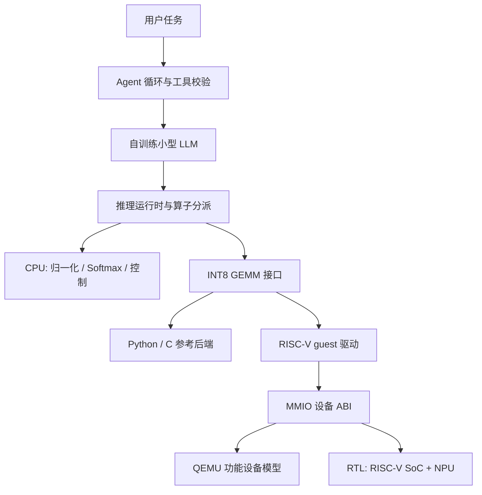

# 系统架构与技术选择

总体学习依赖见 [全景规划图](PROJECT_MAP.md)。CSAPP 的信息表示、处理器、存储、链接、异常、I/O 与并发组成跨层基础，详细映射见 [CSAPP 模块](CSAPP_FOUNDATIONS.md)。书中的 x86-64/Y86-64 教学示例与本项目 RISC-V 目标分别维护，不共享未经适配的二进制与 ABI 假设。

## 端到端数据流

模型与学习方法由 [Understanding Deep Learning 基础](UDL_FOUNDATIONS.md) 支撑，连接损失、梯度、Transformer 与质量评估。训练保留在宿主机，首版 NPU 加速推理线性层；量化和设备接入是本项目独立的工程实验。

这是目标架构，目前只有 Python GEMM 和独立 MAC RTL 实验落地。QEMU 与 RTL 是两种执行环境，共享算子语义和驱动协议；QEMU 不会自动执行 Verilog，也不会自动拥有自定义 NPU。

已有独立芯片实验环境现已作为项目的外部基础设施登记，详见 [本地 EDA 依赖与接入分析](LOCAL_EDA_ENVIRONMENT.md)。这些工具和历史案例尚未组成 AIMakeAll 的 SoC；两套 PDK、不同仿真器版本及 SRAM 交付物必须分别管理。

## 首版选择

| 层 | 默认路线 | 原因与边界 |
| --- | --- | --- |
| RISC-V CPU | Ibex RV32IMC，裸机 | CPU 已开源；教学重点放在系统集成。不是 Linux 平台 |
| 教学 NPU | 自实现 SystemVerilog INT8 MAC → 4×4 阵列 | 算术、数据流和带宽可逐层解释 |
| 硬件验证 | Verilator；后续增加 Yosys 综合 | 软件仿真无需购买板卡；器件适配另做评估 |
| 软件模拟 | QEMU RISC-V 系统模拟 + 自定义 MMIO 设备 | 固定板级映射，尽量复用裸机驱动 |
| 模型训练 | 自写模型结构，PyTorch 自动求导，CPU 起步 | 不需要闭源服务；GPU 加速是可选项 |
| 部署 | C 标量后端 → guest NPU 后端 | 先保证数值一致，再优化 |
| Agent | 简单显式状态机 + JSON 工具协议 | 避免框架掩盖模型、工具与运行时之间的边界 |

Ibex 是面向嵌入式控制的开源 32 位 RISC-V 核，见 [上游项目](https://github.com/lowRISC/ibex)。未来如需 Linux，需另选具有合适特权级、MMU 等支持的 CPU/SoC，并单独维护 RV64 配置。

Gemmini 作为后续对照学习材料：它属于 Chipyard/Chisel 生态，其集成方式和指令接口与本项目 MMIO 路线不同，不能直接当作 Ibex 外设插入。见 [Gemmini 上游](https://github.com/ucb-bar/gemmini)。

## QEMU 的职责

QEMU 支持 32/64 位 RISC-V 系统模拟，但机器模型决定设备与内存映射；`virt` 并非某个真实硬件 SoC 的复制品。见 [QEMU 官方说明](https://www.qemu.org/docs/master/system/target-riscv.html)。

本项目计划先建立可运行软件的虚拟平台，不宣称它精确复现 Ibex 的流水线、缓存或周期。裸机代码的 ISA、链接地址、UART 和 NPU 地址必须与所选机器一致。Linux + RV64 `virt` 属于后续扩展，不能复用 RV32 裸机映像直接启动。

## 如何证明加速

同一模型、同一输入、同一量化精度下分别测量：

1. 宿主机原生 CPU 推理：作为现实使用基线。
2. QEMU guest 的 CPU 标量推理：衡量模拟环境内的软件路径。
3. QEMU guest + NPU 设备后端：衡量设备卸载与宿主机实现带来的变化。
4. RTL/未来 FPGA：记录真实周期或板卡耗时；RTL 仿真的墙钟速度不等于硬件速度。

每项记录预热次数、重复次数、输入形状、线程数、构建选项、中位数与 P95。模型推理分别记录 prefill tokens/s、decode tokens/s、峰值内存与搬运字节数。Agent 另报总任务耗时和任务成功率。

矩阵核心快不等于整个模型快。例如可加速部分占总耗时 70%、该部分快 10 倍时，理想总加速比仅为 `1 / (0.30 + 0.70 / 10) ≈ 2.70`，且还没计入额外搬运开销。

## 内存与模型规模

首版 RV32 采用小模型和短上下文。实际 SRAM/RAM 容量在 SoC 集成前确定，权重、激活、KV cache 与代码必须有显式预算。训练不在教学 NPU 上执行；第一阶段 NPU 仅承担推理的整数矩阵乘法。扩展训练算子需要新的精度、梯度和存储设计。
