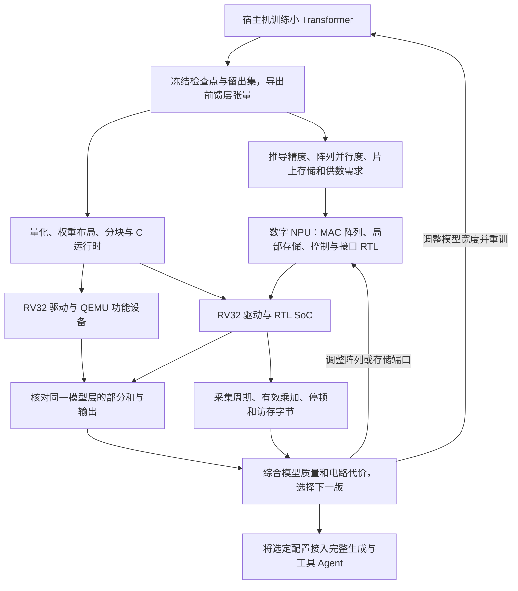

# 芯片设计、模型研发与推理部署个人培养规划（审阅稿）

培养对象是希望独立完成数字 AI 处理器设计、模型研发和推理部署的学习者。三条路线使用同一套模型权重、测试输入和硬件接口。学习者既要能把每一层做出来，也要能在整机运行结果有误或过慢时，查出第一处偏差或主要成本。

首版要交付一台可以在普通电脑上仿真的 RISC-V + 数字 NPU、一个从随机权重训练的小型语言模型，以及一套把两者放在同一个任务上比较和修改的方法。第一个值得展示的成果是：学习者能指着一段 RTL 波形，解释为什么某个已训练模型的前馈层在等待数据，并用实验决定改电路还是改模型。

## 个人毕业任务

给定一项生成任务、数据划分和资源约束，独立交付以下结果。通过代表层的联合实验是中期里程碑，完成整模型部署后再用一个未演示的约束或输入形状检验迁移能力。

| 能力 | 个人交付与考核 |
| --- | --- |
| 芯片设计 | 交付可综合的阵列、局部存储接口与控制器。预测一个尾块的行为和一次背压造成的停顿，用独立整数参考、波形和综合报告核验。说明影响吞吐或时序的一处设计选择 |
| 模型研发 | 从数据和随机权重重建小模型，保留简单基线、数据划分、训练曲线、可恢复检查点及留出集质量。改变一个模型参数，解释训练或泛化结果 |
| 模型推理 | 将同一检查点导出到 CPU 与设备路径。能定位第一处数值分歧，完成整模型生成，分别报告提示词处理与逐 token 生成的质量、访存、CPU 回退和运行成本 |
| 芯模联合诊断 | 在预先冻结的质量门槛下，收紧一项约束，例如将单条命令的缓冲预算减半。先预测影响，固定模型比较硬件，再固定硬件比较模型或推理策略。用同一批输入复测，解释最终选择和一个落选方案，并在新输入上重验 |

当前可练到一次有实测依据的联合设计选择。用已训练权重驱动 4×4 阵列，再把输出放回模型，比较两种存储组织、两种前馈宽度及两种推理场景。实验 03 已让一份客体程序在 QEMU 和 PicoRV32 阵列上生成同一组符号，并记录逐块整数、内存访问与生成步周期。实验 04 在同一台 PicoRV32 上测得默认提示词节省 41,143 拍，后续每个符号多用 907 拍。学习者可据此为单行打包或软件浮点 Q/K/V 选择一项改动，并用新输入复验。[同机基线与试读](../labs/04-rv32-performance/README.md) · [实验 02 与迁移题](../labs/02-trained-projection/README.md)

## 终点和起点

| 最终交付 | 当前可运行 | 首版还要交付 |
| --- | --- | --- |
| 可综合的数字 NPU | 16 个 INT8 MAC、两种 256 B 局部存储、带尾块的 4×4 阵列。微块 MMIO 与地址生成已接入 PicoRV32 | 扩大 K 分块、验证总线仲裁与 Ibex 集成 |
| 虚拟设备与软件 | 同一份 RV32 驱动已通过 QEMU 和 PicoRV32 总线写入对照，QEMU 已检查错误和忙时复位 | 通用模型包加载、执行计划与回退调度 |
| 小语言模型 | 已训练两种宽度的单层符号模型，有 bigram 基线、训练恢复、KV 缓存及留出集质量 | 扩展为字节语料、多层多头模型，检查语料泛化和整模型部署 |
| 芯模联动 | 01 对齐固定 Linear，02 比较硬件×模型四种组合，03 在 RV32 上生成，04 建立同机纯 CPU 对照并拆出整步瓶颈 | 依据实测选择下一项改动并复验，扩至自然语言任务 |
| 应用选修与试读 | 已有规则助手核对两份实验报告的纠错练习 | 自训练模型选择工具，CPU 与 NPU 后端执行同一任务集。发布从干净环境可复现的教材，登记真人试读 |

实验 01 的两档单命令缓冲预算 3212 B、1606 B，对应 K 分块 256+1、122+122+13。实验 02 的 256 B 指阵列内部存储容量，K 为 16。两个实验分别练习跨命令合并与逐周期供数。两种预算口径和设备调用路径在报告里分别记录。[实验 01](../labs/01-linear257/README.md) · [验证记录](VALIDATION.md)

[实验 03 的实施步骤、交付物和验收标准](ROADMAP.md#实验-03-从设备命令追到生成符号)

## 两条线在哪里汇合

首版由宿主训练模型，NPU 执行推理中的整数矩阵乘。RISC-V CPU 负责控制、跨 K 分块的部分和合并与后处理。缩放、偏置、归一化、Softmax、激活和采样先在 CPU 上执行。QEMU 负责设备协议与软件功能验证；Verilator 运行真实设计的 RTL 并记录时钟周期；Yosys 综合数字电路。面积和时序比较要固定工艺库与约束，估算能耗还需要活动率和适用的功耗模型。[系统架构](ARCHITECTURE.md) · [设备契约](../specs/npu-v0.md)

## 实施顺序与阶段出口

编号沿用项目已有的 M0–M4。模型训练可以在硬件设计期间推进。两条线每次交接同一层的输入、权重、布局、量化尺度和预期输出。

| 工作段 | 主要学习内容与实验 | 交付物 | 可以进入下一步的证据 |
| --- | --- | --- | --- |
| M0 共同基线 | 补码、定点乘加、组合与时序逻辑、矩阵布局、量化舍入。完成实验 00/01，手算一个点积，再注入布局错误 | 固定输入、数值契约、错误样例、两档预算报告 | 学习者能定位第一个错误元素，提前预测第三种预算的分块并复算全部结果 |
| M1 计算阵列 | 从一个 MAC 做同步 FIFO、带有效/就绪握手的处理单元，再接成 4×4 阵列。首轮让每个单元保留一个输出的部分和，比较完整块与尾块 | 可综合 RTL、独立整数参考、测试台、关键波形、首份综合报告 | 带符号极值、尾块、背压与复位后重新提交均通过；停顿时部分和与事务标识一致，结果逐项对齐 |
| M1 存储与 SoC | 建模局部 SRAM 的容量、端口和读延迟，加入地址生成、装载、计算、写回和命令状态机，再接 Ibex RV32 裸机 | 存储模型、控制器与片内总线 RTL、内存图、裸机程序、事务计数器 | CPU 能提交完整 GEMM 并读回结果；能从波形找到首次读数、一次停顿及最后写回，坏地址不覆盖输出 |
| M2 运行时与模拟器 | 复用现有 QEMU 设备与裸机驱动。编译侧做形状检查、W 转置打包和 M/N/K 分块，运行时绑定缓冲、提交命令、合并并缩放 | 模型包、C 标量后端与设备后端、逐层差分工具、异常回归 | 同一驱动、同一输入在 QEMU 与 RTL SoC 上得到相同整数结果和软件可见终态；能拒绝坏包并定位第一处分歧 |
| M3 模型与训练 | 从字节分词、右移标签和 bigram 基线开始，自写因果注意力、前馈层、残差、归一化及生成循环。宿主训练并验证断点恢复 | 有来源和许可的语料配方、按文档划分的数据集、浮点检查点、训练曲线、固定评测输入 | 留出集损失优于 bigram；改变未来 token 不影响先前输出；缓存与非缓存推理在约定精度下对齐 |
| M1 × M3 首次联合实验 | 选已训练的前馈层。先把浮点与量化差异定位到层，再把整数结果对齐到阵列。分别重放提示词处理和逐 token 生成 | 真实张量、四种组合的比较表、波形、流量与质量报告、设计决定 | 能用证据决定保留哪种硬件和模型配置，说明设计在什么工作负载或质量门槛下会改变 |
| M3 整模型部署 | 从前馈层扩至 Q/K/V/O 投影及其他支持的线性层，记录 CPU 回退；跑通提示词处理、KV cache 和逐 token 生成 | 可加载的模型包、CPU 与设备推理结果、误差和端到端成本分解 | 整数路径逐项对齐。相对各自 FP32 模型，INT8 的留出集困惑度增幅首轮目标 ≤10%。分别报告两种负载及打包、搬运和回退成本 |
| M4 应用选修与独立复现 | 对自训练模型做受限工具调用微调，以计算、限定文档检索、实验结果查询三类工具构建 Agent | 独立任务集、规则与模型对照、应用轨迹、故障样例、教材与试读记录 | 至少 30 个隔离任务，报告成功率、合法调用率、超时率、模型及整项任务耗时。独立学习者能换一个预算或负载复现结论 |

个人练习可以从单 MAC、固定线性层走到已训练的微型 Transformer。下一档自然语言模型拟使用字节词表、上下文 128、4 层、模型宽度 128、4 个注意力头与前馈宽度 512。扩大前先用短跑记录宿主内存和每步耗时，确定正式训练预算。[硬件路线](../hardware/README.md) · [模型路线](../models/README.md) · [Agent 路线](../agents/README.md)

## 一次完整的芯模联动实验

可运行档已完成 16→32 与 16→24 两个前馈升维投影的比较。下面是尚待实施的扩大档，基线为 128→512，固定 batch 为 1。处理 32 个提示词 token 时输入矩阵为 32×128，每步生成时为 1×128。两者共享 64 KiB 的 INT8 权重，各需 2,097,152 和 65,536 次有效乘加。实际从外存搬多少字节取决于缓存与分块，应由系统边界的计数器测量。

这组形状也检验编译与驱动。v0 每条命令的 M、N、K 上限均为 256，512 个输出通道至少分成两段。N 分块的结果按列拼回原张量，K 分块的结果按同一输出位置相加；两者的合并规则各有一条独立测试。单命令缓冲预算再紧时，还需重新选择块形状。[NPU v0 规格](../specs/npu-v0.md)

| 实验组合 | 硬件 | 模型 | 要回答的问题 |
| --- | --- | --- | --- |
| 基准 | H0：4×4 阵列，固定缓冲与端口 | A：前馈宽度 512 | 两种场景下，阵列有多少计算槽有效？空闲来自尾块、等数据还是控制开销？ |
| 只改硬件 | H1：保留阵列和容量，调整局部存储读带宽，使数据通路可使用新增带宽 | A：复用同一检查点 | 停顿减少了多少？新增端口的综合代价是多少？外存带宽固定时收益是否还在？ |
| 只改模型 | H0 | B：前馈宽度 384，按相同训练 token 预算重训 | 单个投影权重从 64 降至 48 KiB。减少的字节与周期是否值得相应的留出集质量变化？ |
| 检查组合 | H1 | B：复用 B 的检查点 | 模型变窄以后，新增读带宽是否还值得保留？ |

每行都跑提示词和逐 token 两种场景。固定分词、数据划分、输入、量化方法、存储边界、时钟约束和外存假设。先证明同一个模型在两种硬件上的整数结果一致，再比较周期。记录有效 MAC 数、总周期、按原因划分的停顿、跨外存边界的字节数及综合面积口径。如果首轮轨迹显示等待来自外存或计算，记录 H1 可能无收益的预测，并据此安排下一轮。

模型比较有两道质量检查。先比较 A、B 各自的浮点留出集损失，判断缩小宽度的影响；再将每个量化模型与其自身浮点基线对照，判断量化的影响。正式对照前写明允许的质量退化与资源上限。以满足门槛的候选为范围，分别给出提示词和生成阶段的选择。单层重放可以证明算子成本，整模型收益还要将 CPU 算子、搬运和回退计入。

## 资源预算与实施风险

| 情况 | 实施选择 | 能交付的结论 |
| --- | --- | --- |
| 单人机器训练慢或内存紧 | 先用小语料、单层和短上下文验证训练恢复；按实测每步时间及峰值内存确定正式 token 预算，两种宽度使用同一预算 | 小配置可验证训练与部署方法。正式模型的质量结论取自相应检查点和留出集 |
| RTL 整模型仿真耗时过长 | 用 QEMU 完成全模型功能回归，把同一运行中导出的代表层和边界命令送入 RTL；另保留短序列的整机冒烟测试 | 逐项标出直接测得的 RTL 周期、按覆盖层推算的成本、尚待整机测量的成本 |
| 需要判断速度、面积或能耗 | 固定输入、精度、时钟和存储假设，与相同工作量的 CPU 路径比较；面积固定库和工艺角，能耗固定活动与测量范围 | 功能仿真的宿主墙钟单列。缺少库或活动数据时先交周期、字节和通用综合资源计数 |

已有教学预算建议轻量单任务额外内存 2 GiB、短跑 10 分钟，电路与小模型单任务额外内存 8 GiB、短跑 60 分钟。这些是首次试跑的规划上限；训练总时长和所需磁盘在本机短跑后登记。Agent 的综合验收另有独立任务成功率与响应预算。[课程预算与验收](CHIP_AI_COMPLETENESS.md)

## 一个人的学习节奏

以下为单人每周约 8–10 小时、已有 Python 和基础 C 的排期草案。各阶段按交付证据推进。首轮两周用实际学习时长和调试记录校准后续安排。

| 建议时间 | 主攻任务 | 阶段演示 |
| --- | --- | --- |
| 第 1–2 周 | 完成 00/01，手算、看波形、重放错误；补数字逻辑和矩阵运算 | 解释从权重字节到首个输出的全过程 |
| 第 3–8 周 | 主攻 FIFO、握手和 4×4 阵列；穿插字节语料和 bigram | 阵列跑通小矩阵和尾块，模型侧有可比较的基线 |
| 第 9–16 周 | 主攻存储与控制、驱动及 SoC；穿插小 Transformer 训练和恢复 | 同一条裸机命令完成读写；模型侧交付可复现的浮点检查点 |
| 第 17–24 周 | 导出真实张量、补齐运行时，用两种负载做四组联合对照 | 交付第一份有模型质量与 RTL 证据的设计决定。这是芯模联动的中期里程碑 |
| 第 25–36 周 | 完成整模型生成、异常定位与新约束下的个人毕业任务；有余力再接工具 Agent | 在新输入上复验 CPU/设备结果，解释模型质量与硬件代价，并留存个人设计报告 |

最早的两次独立提交可以很小。第一份是 FIFO 在“写满、消费者停顿、同时读写、复位”四种情况下的波形与计数。第二份是从固定语料生成训练窗口，手算一段标签，并得到 bigram 的留出损失。两份都完成后，学习者就能分别检查硬件在传什么、模型在学什么。

## 知识体系怎样为主线服务

| 遇到的设计问题 | 此时学习的内容 | 深入方向 |
| --- | --- | --- |
| 一个 MAC 为何给出这个数？ | 补码、位宽、舍入、累加、数字逻辑与时序；CSAPP 的数据表示 | 算术电路、形式验证、库映射与静态时序分析 |
| 如何把数据及时送到阵列？ | 体系结构、SRAM、局部性、FIFO、地址与仲裁；用算法和 OSTEP 理解调度与所有权 | DRAM、片上网络、PCIe/CXL、ECC、功耗与数字物理实现 |
| 为什么改模型？质量损失可接受吗？ | 线代、概率、优化、反向传播、注意力和评测；结合 UDL 与《Build a Large Language Model (From Scratch)》推导和实现 | MiniMind 训练流程对照、多模态、经典 AI、分布式训练及因果分析 |
| 模型怎样在处理器上运行？ | C/ABI、RISC-V、AI 编译、布局、量化、设备驱动、仿真可信度和性能工程 | LFS/Linux 驱动、网络服务、多设备运行时 |
| 推理改善是否对用户有用？ | 检索、工具决策、状态恢复、人工接管、质量与总成本 | 实时控制、具身任务、生产服务和可靠性 |

教材以原创讲解配合开源代码和有明确许可的数据。核心实验在电脑内用软件参考、RTL 仿真和综合完成。每章附前置自检、推导、输入与预期、故障排查、迁移题、版本和运行证据；作者复现、自动回归、独立读者完成分别登记。总规划沿用现有一级目录，详细专题继续使用原课程编号。[课程目录](CURRICULUM.md) · [知识覆盖图](KNOWLEDGE_COVERAGE.md) · [开源与复现规则](OPEN_SOURCE.md)
