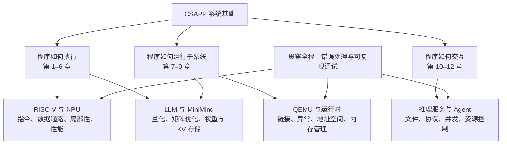

# CSAPP 计算机系统基础：完整知识体系与项目映射

日期：2026-11-17。按用户所说的“csaap”指 **CSAPP / CS:APP《深入理解计算机系统》**整理，以第三版为章节基准。作者为 Randal E. Bryant 与 David R. O'Hallaron。

本模块作为 AIMakeAll 四条主线共同的系统基础。这里提供原创知识梳理、学习目标和项目实验设计，不替代原书，不复制正文、题库或答案。**当前完成的是全书章节级覆盖与实验规划，新增实验尚未实现。**

## 1. 在项目中的位置

章节名称和顺序按 [出版社第三版目录](https://www.pearson.com/en-us/pearsonplus/p/9780138105396) 核对。下文细化内容为本项目的学习组织方式，不是原书目录或正文的完整转录。

## 2. 全书知识体系与项目实验

使用 `CS01–CS12` 标识基础模块，保持原有 AI 单元 `00–16` 编号不变。表中实验均为本项目设计；CS02 可以复用已通过的 INT8 实验作为起点，但不代表该基础模块已经验收。

| 模块 / 书中章节 | 应掌握的核心知识 | AIMakeAll 原创实验与应用 | 完成标准 |
| --- | --- | --- | --- |
| CS01 / 1. 计算机系统漫游 | 信息的解释方式；编译、链接、加载和执行；硬件与操作系统分工；抽象与性能 | 追踪一个 C 点积程序从源码到运行结果，画出它与 Python、guest 和 NPU 的关系 | 保存构建产物，解释每一步由谁完成，以及数据存放在哪里 |
| CS02 / 2. 信息的表示和处理 | 位运算、补码、符号扩展、类型转换、整数边界；浮点编码、舍入与精度 | INT8/INT32 边界，定点缩放、量化与反量化；比较 Python、C、RTL | 极值和随机向量一致；区分回绕、饱和、量化误差及 C 未定义行为 |
| CS03 / 3. 程序的机器级表示 | 寄存器、寻址、控制流、函数调用、栈帧；数组、结构体与对齐；调试 | 同一个 C 点积分别查看宿主机与 RISC-V 汇编，解释参数、返回值和访存 | 能单步跟踪一轮计算并定位一次越界；明确目标 ISA 与 ABI |
| CS04 / 4. 处理器体系结构 | 指令语义、组合与时序逻辑、数据通路、控制；流水线、冒险、转发、停顿 | 用书中简化处理器理解设计方法，再解释 RISC-V 核与 NPU MAC 控制器 | 时序/握手图与仿真一致；能说明流水线停顿和阵列计算的区别 |
| CS05 / 5. 优化程序性能 | 测量基线、编译器优化边界、别名、循环展开、依赖链、延迟与吞吐 | C GEMM 循环次序、分块与实现对照；分别测 prefill 和 decode | 每项优化先验证正确性，记录输入、构建参数、重复测量与端到端耗时 |
| CS06 / 6. 存储器层次结构 | SRAM/DRAM、局部性、cache 组织与替换、写策略、带宽与工作集 | 矩阵访问轨迹与简单 cache 模型；设计 NPU tile buffer 和权重搬运 | 解释访存次数、复用和工作集；分别统计计算与搬运，验证模拟器的已知小轨迹 |
| CS07 / 7. 链接 | 符号、目标文件、重定位、静态/动态链接、共享库、位置无关代码 | RISC-V ELF、链接脚本、启动入口和内存映射；推理后端模块边界 | 用工具验证段/节/符号/入口；故意缺符号或放错地址时能解释失败 |
| CS08 / 8. 异常控制流 | 异常、中断、陷阱；进程、系统调用、信号、回收与非局部控制转移 | 裸机 trap/中断处理与宿主机子进程实验分开；模拟器超时及 Agent 工具取消 | 正常完成、异常、超时与取消均有明确结果；不混淆 CPU 异常和 Unix 信号 |
| CS09 / 9. 虚拟内存 | 虚实地址、页表、TLB、缺页、保护、映射；堆分配、碎片与内存错误 | 区分 host VA / guest PA / guest VA；设计权重加载、arena 和 KV cache 生命周期 | 地址边界校验、峰值内存与释放正确；不声称首版裸机具有 Linux 虚拟内存 |
| CS10 / 10. 系统级 I/O | 文件描述符、短读写、缓冲、元数据、文件共享与重定向 | 模型文件加载、checkpoint 保存、校验和、截断文件与错误日志 | 处理截断、错误长度与 I/O 失败，不接受半写入模型为有效产物 |
| CS11 / 11. 网络编程 | 客户端/服务器、地址与端口、DNS、字节序、socket、HTTP 与消息边界 | 本地推理协议与 Agent 工具服务；请求长度、流式响应和断连处理 | 正确处理拆包、半包、断连和超时；接口兼容不等于服务实现相同 |
| CS12 / 12. 并发编程 | 进程、线程、I/O 多路复用；共享状态、同步、竞争、死锁、线程安全 | 有界推理任务队列、请求级 KV 状态、日志收集、取消和资源回收 | 多请求不串数据；队列有上限；重复压力测试无丢任务、死锁或资源泄漏 |

错误处理作为贯穿所有模块的要求：明确返回值、异常传播、资源释放与部分失败；对照原书的错误处理附录理解系统调用检查。本项目每个实验都应包含至少一个可预测失败的用例。

## 3. 重点迁移到 AI 系统的概念

### 数值表示 → 量化与 NPU 算术

INT8 是存储与算术类型，scale 决定它代表的实数范围。浮点权重直接转成整数不等于完整量化。硬件定义的 INT32 回绕也不能用 C 的有符号溢出来模拟；C 参考实现必须采用有定义的算术和转换方式。

先完成当前 [INT8 实验](../labs/00-int8-matmul/README.md)，再增加浮点误差、量化误差和校准分析。量化器、导出器和设备实现必须共同遵守 [NPU 规范](../specs/npu-v0.md)。

### 局部性与性能 → 阵列、权重和 KV cache

CPU cache 是硬件缓存，Transformer 的 KV cache 是软件维护的注意力状态；二者不是同一种缓存。NPU scratchpad 通常由软件或控制器显式管理，也不能直接套用 CPU cache 的替换规则。

将计算量、搬运字节数、访问模式和工作集一起分析。对 MiniMind 的大矩阵分块时，还需处理 INT32 部分结果合并；矩阵核心提速不自动等于模型或 Agent 总任务提速。

### 链接与内存 → 裸机、QEMU 与模型加载

编译目标、ISA、ABI、链接地址和运行环境要相互匹配。首版 RV32 裸机使用物理地址与静态内存预算；进程、`mmap`、线程和 socket 等系统接口放在宿主机或另行建设的 Linux 环境中学习。Linux guest 是后续扩展，不能暗示 Ibex 裸机具备相同能力。

QEMU 设备处理的是 guest 地址，不能将其直接转为宿主机指针。加载模型文件时要检查形状、长度、偏移与整数溢出；权重共享、KV 生命周期与临时缓冲区分别管理。

### 异常、I/O 与并发 → 可靠 Agent

生成一次工具调用只是开始；程序还要处理校验失败、工具超时、客户端断连和取消后的清理。先做单请求闭环，再加入有界并发和背压。`volatile` 不提供线程同步，也不能替代设备访问协议要求的内存屏障。

网络协议、线程与 HTTP 服务是推理应用的系统能力，不是模型训练能力；应分别编写测试与性能报告。

## 4. 官方实验如何衔接

[官方 Labs 页面](https://csapp.cs.cmu.edu/3e/labs.html) 提供自学材料入口。以下为项目对照练习，不是官方实验移植或答案。是否使用官方代码，要逐项核验其适用条款和环境。

| 官方实验主题 | 对应模块 | 本项目设计的练习 |
| --- | --- | --- |
| Data Lab | CS02 | 位级算术、量化边界与符号扩展 |
| Bomb Lab | CS03 | 自编程序的反汇编、条件分支与调试 |
| Attack Lab | CS03、CS09 | 自有隔离示例中的栈边界与输入校验，观察修复前后行为 |
| Architecture Lab | CS04 | 简化流水线的周期分析，迁移到 RISC-V/NPU 控制逻辑 |
| Cache Lab | CS06 | 自有矩阵轨迹、cache 模型与分块对照 |
| Performance Lab | CS05、CS06 | GEMM 基线、访存优化与测量方法 |
| Shell Lab | CS08、CS12 | 训练任务启动、信号、取消与子进程回收 |
| Malloc Lab | CS09 | 对齐分配器、静态 arena、内存利用率和碎片 |
| Proxy Lab | CS10–CS12 | 本地有界请求服务、协议解析、缓存策略与并发控制 |

官方还保留部分旧版实验；本项目以第三版主题为基准，不把历史 IA32 / Y86 版本当作当前架构目标。官方材料可以自学获取，并不意味着它们与原书都能按 MIT 再发布。

## 5. Apple Silicon、x86-64 与 RISC-V 的环境边界

第三版以 x86-64 机器代码讲解，处理器章节使用教学 ISA；本项目硬件目标则是 RISC-V。概念可以对照，指令、寄存器、调用约定和二进制不能直接互换。[出版社介绍](https://www.pearson.com/en-us/pearsonplus/p/9780138105396)

| 学习环境 | 适合完成的内容 | 注意事项 |
| --- | --- | --- |
| Apple Silicon macOS 原生 | 可移植 C、数值实验、基础优化、部分 POSIX 文件/进程/线程/socket 实验 | 原生为 ARM64，目标文件通常为 Mach-O；不能将输出当成 Linux ELF 或 x86-64 |
| Linux x86-64 环境 | 官方面向 Linux/x86-64 的二进制与特定实验 | 官方 Cache Lab 明确要求 x86-64；需独立验证 Linux/工具版本，ARM64 容器不能直接代替 |
| RISC-V 裸机 / QEMU | 交叉编译、ELF、启动、trap、MMIO 和 NPU 驱动 | 不提供默认的进程、虚拟内存和网络服务；由具体机器与软件决定 |
| 未来 RISC-V Linux | 虚拟内存、系统调用、进程和网络在 guest 中的实验 | 需要支持相应特性的 CPU/平台，作为单独扩展路线 |

工具按环境分别检查：C 编译器、Make、调试器、反汇编/目标文件工具、必要的分析器。macOS 可用 LLDB 和对应系统工具；Linux 练习按实验要求使用 GDB/binutils 等。当前只完成环境规划，没有新增 Linux/x86-64 实验环境，也未安装官方实验包。

同一实验报告必须写明宿主架构、目标架构、操作系统、编译选项和测量范围。跨 ISA 仿真的墙钟时间不能用来推断原生 CPU 的微架构性能。

## 6. 学习顺序与四阶段依赖

现有模块增加两组深化入口：[ARCH-E1–E6](ARCHITECTURE.md) 展开 CS04–CS06 的数据流、存储层次、可见性和性能模型；[SW-E1–E6](SYSTEMATIC_VERIFICATION.md) 展开 CS02/CS03/CS09/CS10 的 C 语义、坏包校验、所有权、自动检测与可复现构建。CS10–CS12 的持久任务与权限实验接 [STATE-E1–E6](ENGINEERING_BRIDGES.md)。均为原创待实现计划，不是官方 Labs 答案或新增章节。

| 项目阶段 | 优先学习 | 与现有课程的连接 |
| --- | --- | --- |
| 起步 | CS01、CS02，加 C 指针/数组基础 | 实验 00，建立统一数值语义 |
| M1 硬件 | CS03、CS04、CS06；CS05/CS07 按需进入 | 单元 01–04，阵列、总线、固件与物理实验 |
| M2 模拟器与运行时 | CS07、CS08、CS09、CS10 | 单元 05–07，加载、设备边界、错误与内存管理 |
| M3 模型与 MiniMind | CS02、CS05、CS06、CS09、CS10 | 单元 08–13，数值、性能、数据/模型文件和缓存 |
| M4 Agent | CS08、CS10、CS11、CS12 | 单元 14–16，工具进程、协议、服务与并发 |

不要求读完全书再开始项目。每个阶段先掌握所需概念，以项目实验巩固，再回到书中系统阅读。所有 12 章在整体路线中均有位置，早期硬件闭环不依赖先实现网络服务。

## 7. 验收与资料组织

每个 CS 模块产出四项内容：原创概念笔记、可运行实验、至少一个失败/边界用例，以及与 AI 主线的连接说明。环境和命令经过实际执行后才能标为“已验证”。

- 当前已有：全章映射、实验设计、环境边界、学习顺序，以及可复用的 INT8 起点。
- 后续首项：CS01 的 C 点积构建追踪，加 CS02 的可移植 C/RTL 数值对照。
- 暂未完成：CS01–CS12 实验实现、官方 Labs 复现与本机跨架构环境验收。

## 8. 正版与开放资料入口

- [出版社第三版介绍与目录](https://www.pearson.com/en-us/pearsonplus/p/9780138105396)：核对书目、章节与架构基准。
- [作者官网](https://csapp.cs.cmu.edu/3e/)：课程与配套资源入口。
- [作者提供的目录与前言](https://csapp.cs.cmu.edu/3e/pieces/preface3e.pdf)：公开预览资料。
- [学生资源](https://csapp.cs.cmu.edu/3e/students.html)：补充阅读与示例入口。
- [官方 Labs](https://csapp.cs.cmu.edu/3e/labs.html)：实验说明与自学材料。

本项目维持开源实验主线，CSAPP 作为参考读物。原书和官方材料不因被引用而成为本项目的开源内容；未经适用许可，不收入教材扫描件、整本电子书、完整题库、教师资料或官方答案。
