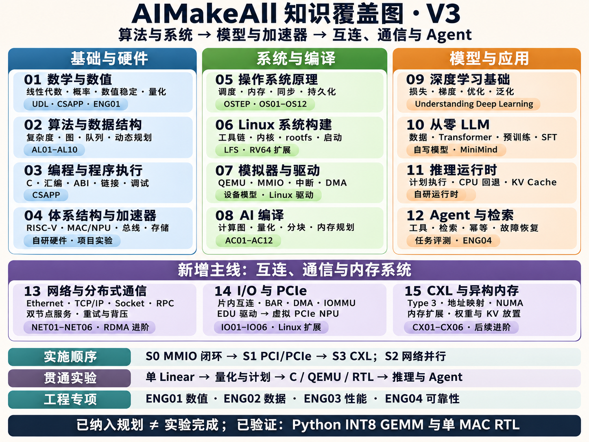

# AIMakeAll 知识覆盖范围

更新：2026-11-17。V3 在算法、OSTEP、AI 编译与四个工程专项基础上，新增网络、I/O 与 PCIe、CXL 与异构内存，形成十五个领域。覆盖表示已纳入学习规划，尚不代表实验完成。

## 十五个领域及阅读入口

| 图中编号 | 领域 | 主要学习内容 | 文档入口 |
| --- | --- | --- | --- |
| 01 | 数学与数值 | 线性代数、微积分、概率、稳定性和量化误差 | [UDL](UDL_FOUNDATIONS.md)、[ENG01](ENGINEERING_BRIDGES.md) |
| 02 | 算法与数据结构 | 复杂度、容器、排序、图、动态规划与索引 | [AL01–AL10](ALGORITHMS_FOUNDATIONS.md) |
| 03 | 编程与程序执行 | C、汇编、ABI、链接、调试和性能 | [CSAPP](CSAPP_FOUNDATIONS.md) |
| 04 | 体系结构与加速器 | 数字逻辑、RISC-V、MAC/NPU、总线和存储 | [硬件](../hardware/README.md)、[架构](ARCHITECTURE.md) |
| 05 | 操作系统原理 | 调度、虚拟内存、同步、文件系统和持久化 | [OS01–OS12](OSTEP_FOUNDATIONS.md) |
| 06 | Linux 系统构建 | 工具链、用户态、内核、rootfs、启动和服务 | [LFS](LFS_FOUNDATIONS.md) |
| 07 | 模拟器与驱动 | QEMU、虚拟设备、MMIO、中断和 DMA | [模拟器](../simulator/README.md)、[NPU 规范](../specs/npu-v0.md) |
| 08 | AI 编译 | 计算图、IR、布局/量化、分块、内存及执行计划 | [AC01–AC12](AI_COMPILATION.md) |
| 09 | 深度学习基础 | 模型表达、损失、梯度、优化与泛化 | [UDL](UDL_FOUNDATIONS.md) |
| 10 | 从零 LLM | 数据、分词、Transformer、预训练与 SFT | [模型](../models/README.md)、[MiniMind](MINIMIND_INTEGRATION.md)、[ENG02](ENGINEERING_BRIDGES.md) |
| 11 | 推理运行时 | 计划执行、算子分派、内存、KV 与设备调用 | [运行时](../runtime/README.md)、[AI 编译](AI_COMPILATION.md) |
| 12 | Agent 与检索 | 索引排序、工具协议、状态、重试与任务评估 | [Agent](../agents/README.md)、[ENG04](ENGINEERING_BRIDGES.md) |
| 13 | 网络与分布式通信 | Ethernet/TCP/IP、Socket/RPC、背压与重试、RDMA 进阶 | [NET01–NET06](NETWORKING_FOUNDATIONS.md) |
| 14 | I/O 与 PCIe | 片内互连、枚举/BAR、DMA/IOMMU、中断与 Linux 驱动 | [IO01–IO06](PCIE_IO_FOUNDATIONS.md) |
| 15 | CXL 与异构内存 | 协议与一致性、Type 3、地址译码、NUMA 与模型内存放置 | [CX01–CX06](CXL_MEMORY_FOUNDATIONS.md) |

图中中断、DMA、Linux 驱动等表示课程范围；当前 NPU v0 首版仍为同步轮询，不据图示扩大设备能力。CSAPP、OSTEP、LFS 分别侧重程序视角、系统机制和系统构建。

网络连接节点，PCIe 连接主机与设备，CXL 连接扩展内存并引入一致性相关机制。新增模块按 [S0–S3 阶段](ROADMAP.md) 推进：S0 MMIO 闭环 → S1 PCI/PCIe → S3 CXL；S2 网络可先用 CPU 服务并行，远程 NPU 接入另需本地后端验收。

## 四个工程专项

[ENG01–ENG04](ENGINEERING_BRIDGES.md) 覆盖数值量化、数据训练、性能与系统验证、检索与 Agent 可靠性。每项都规定输入、实现产物、边界/故障用例及验收证据，贯穿 M1–M4，而不是只增加阅读书目。

## 范围与当前深度

- **主线规划**：算法与系统基础、RISC-V/NPU、QEMU、自写模型、AI 编译、运行时和受限 Agent。
- **并行与系统扩展**：网络 CPU 服务可独立起步；Linux PCI/PCIe NPU、CXL Type 3 内存与放置实验逐阶段验收，RDMA 为进阶。
- **其他后续扩展**：LFS/RV64 Linux 实践、外部 EDA/SRAM/物理实现迁移、CNN/GNN、其他生成模型、Agent RL。
- **尚未建立系统课程**：多 GPU/分布式训练、生产级服务集群、完整数据库、芯片制造与封装测试。
- **当前已验证起点**：Python INT8 GEMM、单 MAC RTL 及已有基线测试；新模块属于文档和实验规划。

首先打通一个线性层的量化与分块计划、C 运行时、QEMU/RTL 对照，再扩大到完整模型与 Agent。[整体规划](PROJECT_MAP.md) 给出依赖，[里程碑](ROADMAP.md) 给出验收顺序。

## 图片维护

V3 使用内置图像生成工具在 [V2](images/knowledge-coverage-v2.png) 基础上更新，[提示词](images/knowledge-coverage-v3.prompt.txt)保留主题、编号和文案。[V1](images/knowledge-coverage-v1.png) 与 V2 保留为历史资产。上表作为可检索的文字索引；后续范围变化时同步更新图片、课程与里程碑。
