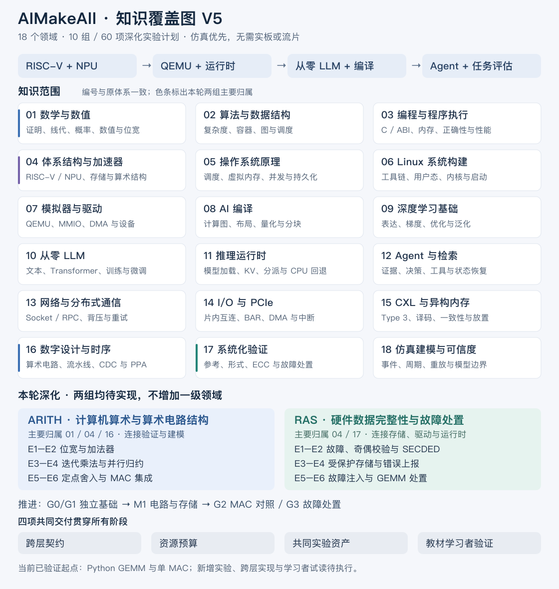

# AIMakeAll 知识覆盖范围

更新：2026-11-17。V5 保持十八个领域，本轮增加 ARITH 算术电路与 RAS 数据完整性两组、12 个待实现子实验，累计十组、60 项深化实验。跨层契约、资源预算、共同资产和学习者验证继续贯穿全部课程。DD/DV/SIM 的 24 个模块继续以同步 FIFO 为共同起点。覆盖表示已纳入规划，尚不代表实验完成。

## 十八个领域及阅读入口

V5 表示知识范围，图下方两条深化路线归入既有领域；交付方式统一按 [仿真优先原则](SIMULATION_FIRST.md)：数字电路设计与综合、协议/RTL 仿真、QEMU 系统模拟。实板与流片不作为核心要求；新增教学数字子模块不等于完整 PCIe/CXL 标准实现。

| 图中编号 | 领域 | 主要学习内容 | 文档入口 |
| --- | --- | --- | --- |
| 01 | 数学与数值 | 离散与证明、线性代数、微分、优化、概率信息量、数值统计、位宽与舍入 | [UDL / MATH-E1–E6](UDL_FOUNDATIONS.md)、[ENG01](ENGINEERING_BRIDGES.md)、[ARITH](DIGITAL_DESIGN_TIMING.md) |
| 02 | 算法与数据结构 | 复杂度、容器、排序、图、动态规划与索引 | [AL01–AL10](ALGORITHMS_FOUNDATIONS.md) |
| 03 | 编程与程序执行 | C/ABI、内存语义、所有权、复现、SIMD 与线程性能 | [CSAPP](CSAPP_FOUNDATIONS.md)、[SW-E](SYSTEMATIC_VERIFICATION.md)、[PERF-E](ENGINEERING_BRIDGES.md) |
| 04 | 体系结构与加速器 | RISC-V/NPU、算术结构、缓存/一致性、DRAM/互连、数据完整性与面积/能耗 | [硬件](../hardware/README.md)、[ARCH / MEM / RAS](ARCHITECTURE.md)、[ARITH / PPA](DIGITAL_DESIGN_TIMING.md) |
| 05 | 操作系统原理 | 调度、虚拟内存、同步、文件系统、事务恢复与权限 | [OS01–OS12](OSTEP_FOUNDATIONS.md)、[状态实验](ENGINEERING_BRIDGES.md) |
| 06 | Linux 系统构建 | 工具链、用户态、内核、rootfs、启动和服务 | [LFS](LFS_FOUNDATIONS.md) |
| 07 | 模拟器与驱动 | QEMU、虚拟设备、MMIO、中断和 DMA | [模拟器](../simulator/README.md)、[NPU 规范](../specs/npu-v0.md) |
| 08 | AI 编译 | 计算图、IR、布局/量化、分块、内存及执行计划 | [AC01–AC12](AI_COMPILATION.md) |
| 09 | 深度学习基础 | 模型表达、损失、梯度、优化与泛化 | [UDL](UDL_FOUNDATIONS.md) |
| 10 | 从零 LLM | 数据、分词、GPT 逐层实现、预训练、分类/指令微调 | [模型 / LLMs From Scratch 七章映射](../models/README.md)、[MiniMind](MINIMIND_INTEGRATION.md)、[ENG02](ENGINEERING_BRIDGES.md) |
| 11 | 推理运行时 | 计划、校验/所有权、KV、优化 CPU 后端、并行开销与设备调用 | [运行时](../runtime/README.md)、[AI 编译](AI_COMPILATION.md)、[PERF-E](ENGINEERING_BRIDGES.md) |
| 12 | Agent 与检索 | 排序/上下文、计划/终止、质量消融、权限、持久状态与恢复 | [Agent / AGQ-E](../agents/README.md)、[STATE-E1–E6](ENGINEERING_BRIDGES.md) |
| 13 | 网络与分布式通信 | Ethernet/TCP/IP、Socket/RPC、背压与重试、RDMA 进阶 | [NET01–NET06](NETWORKING_FOUNDATIONS.md) |
| 14 | I/O 与 PCIe | 片内互连、枚举/BAR、DMA/IOMMU、中断与 Linux 驱动 | [IO01–IO06](PCIE_IO_FOUNDATIONS.md) |
| 15 | CXL 与异构内存 | 协议与一致性、Type 3、地址译码、NUMA 与模型内存放置 | [CX01–CX06](CXL_MEMORY_FOUNDATIONS.md) |
| 16 | 数字设计与时序 | HDL、加法器/乘法器/MAC、定点舍入、流水线/FIFO、CDC、综合/STA 与 PPA | [DD / ARITH / PPA](DIGITAL_DESIGN_TIMING.md) |
| 17 | 系统化验证 | 需求追溯、参考/断言、形式/等价、程序检测、ECC/故障处置与复现 | [DV / SW / 算术与故障验证](SYSTEMATIC_VERIFICATION.md)、[RAS](ARCHITECTURE.md) |
| 18 | 仿真建模与可信度 | 模型边界、事件调度、周期/事务、重放、校验/校准与敏感性 | [SIM01–SIM08](SIMULATION_CREDIBILITY.md) |

图中中断、DMA、Linux 驱动等表示课程范围；当前 NPU v0 首版仍为同步轮询，不据图示扩大设备能力。CSAPP、OSTEP、LFS 分别侧重程序视角、系统机制和系统构建。

网络连接节点，PCIe 连接主机与设备，CXL 连接扩展内存并引入一致性相关机制。新增模块按 [S0–S3 阶段](ROADMAP.md) 推进：S0 MMIO 闭环 → S1 PCI/PCIe → S3 CXL；S2 网络可先用 CPU 服务并行，远程 NPU 接入另需本地后端验收。

## 十组深化内容如何归入现有体系

| 深化内容 | 主要归属与实验入口 | 新增的验收证据 |
| --- | --- | --- |
| 体系结构与存储系统 | 04 → 05/08/11/14/15；[ARCH-E1–E6](ARCHITECTURE.md) | 访问/容量账本、周期与冲突、缓存轨迹、可见性反例、有限状态性质、设计空间报告 |
| 数学基础 | 01 → 02/09/16/18；[MATH-E1–E6](UDL_FOUNDATIONS.md) | 推导与反例、残差/梯度对照、条件数与收敛、概率指标、误差与统计波动 |
| 软件正确性与可复现工程 | 03/17 → 06/08/11/18；[SW-E1–E6](SYSTEMATIC_VERIFICATION.md) | C 数值语义、坏包拒绝、检测语料、资源回收、环境 manifest、跨层回归 |
| 持久状态与安全 | 05/12/13；[STATE-E1–E6](ENGINEERING_BRIDGES.md) | 权限边界、任务状态、崩溃恢复、未知结果处理、攻击/资源限制用例、脱敏审计 |
| 并行计算与性能工程 | 02/03/04/11/18；[PERF-E1–E6](ENGINEERING_BRIDGES.md) | 同语义基线、向量化证据、线程伸缩/同步、重叠条件与分层性能报告 |
| 存储控制器与片上互连 | 04 → 07/14/15/16/17/18；[MEM-E1–E6](ARCHITECTURE.md) | 地址/事务守恒、DRAM 时序、调度公平、仲裁 RTL、NoC 模型与联合瓶颈 |
| 功耗能耗与面积权衡 | 04/16/18；[PPA-E1–E6](DIGITAL_DESIGN_TIMING.md) | 同库面积/时序、活动覆盖、任务能量、低活动设计与条件性 Pareto 比较 |
| Agent 检索与决策质量 | 02/09/10/12；[AGQ-E1–E6](../agents/README.md) | 标注/留出任务、排序指标、引用依据、动作/终止、多步策略、质量与成本消融 |
| 计算机算术与算术电路结构 | 01/04/16 → 17/18；[ARITH-E1–E6](DIGITAL_DESIGN_TIMING.md#dd01dd02dd07-深化计算机算术与算术电路结构) | 位宽/舍入、加法器/乘法器穷举、事务等价、MAC 集成、同约束结构比较 |
| 硬件数据完整性与故障处置 | 04/17 → 07/11/14/15/16/18；[RAS-E1–E6](ARCHITECTURE.md#领域-04-与-17-深化硬件数据完整性与故障处置) | 奇偶漏检反例、SECDED、受保护存储、CE/UE 上报、故障重放与结果失效 |

以上为十组各六项的待实现子实验，不是十个新增一级领域。它们深化已有领域，不增加图中一级编号或仓库一级目录；详细实施顺序见 [整体规划](PROJECT_MAP.md) 和 [里程碑](ROADMAP.md)。V5 同时展示十八个领域及本轮两组深化路线；完整十组索引以本表为准。

## 方法课程与四个工程专项

DD/DV/SIM 是贯穿各领域的方法课程，按 [G0–G3 门槛](ROADMAP.md) 组织：契约 → 同步 FIFO → 单 Linear → 系统扩展。领域 04 关注计算体系结构与 NPU，领域 16 负责可复用数字设计基本功；领域 07 关注 QEMU/驱动，领域 18 负责模型适用性与结论可信度。两两连接，不重复计算实现进度。

[ENG01–ENG04](ENGINEERING_BRIDGES.md) 覆盖数值量化、数据训练、性能与系统验证、检索与 Agent 可靠性。每项都规定输入、实现产物、边界/故障用例及验收证据，贯穿 M1–M4，而不是只增加阅读书目。

## 知识覆盖如何转为可验收交付

| 共同工作 | 覆盖关系 | 验收证据入口 |
| --- | --- | --- |
| 跨层契约 | 连接 04/07/08/10/11，并由 17/18 检查 | [规范版本、能力、校验与差分](SYSTEMATIC_VERIFICATION.md#跨层契约的实施与验收) |
| 资源预算 | 贯穿硬件/仿真、训练、推理与 Agent | [静态账本、实测、上限及扩规模决策](ENGINEERING_BRIDGES.md#资源预算的实施与验收) |
| 共同实验资产 | 各领域共用输入、期望、数据划分和故障轨迹 | [资产 ID/哈希、独立参考与重放](ENGINEERING_BRIDGES.md#共同实验资产的实施与验收) |
| 教材学习者验证 | 贯穿全部章节，按学习路线逐章验收 | [作者复现、独立试读与迁移排错任务](CURRICULUM.md#教材学习者验证的实施与验收) |

这四项是既有课程的交付方法，尚待实施；不计为新增四个一级领域，也不计入十组深化实验的数量。V5 底部展示四项共同交付，详细实施关系由 [全景规划](PROJECT_MAP.md#贯穿全景的四项共同交付) 与 [阶段安排](ROADMAP.md#四项共同交付的阶段安排) 补充。

## 范围与当前深度

- **主线规划**：算法与系统基础、RISC-V/NPU、QEMU、自写模型、AI 编译、运行时和受限 Agent。
- **并行与系统扩展**：网络 CPU 服务可独立起步；Linux PCI/PCIe NPU、CXL Type 3 内存与放置实验逐阶段验收，RDMA 为进阶。
- **其他后续扩展**：LFS/RV64 Linux 实践、外部 EDA/SRAM/物理实现迁移、CNN/GNN、其他生成模型、Agent RL。
- **尚未建立系统课程**：多 GPU/分布式训练、生产级服务集群、完整数据库、芯片制造与封装测试。
- **当前已验证起点**：Python INT8 GEMM、单 MAC RTL 及已有基线测试；新模块属于文档和实验规划。

首先打通一个线性层的量化与分块计划、C 运行时、QEMU/RTL 对照，再扩大到完整模型与 Agent。[整体规划](PROJECT_MAP.md) 给出依赖，[里程碑](ROADMAP.md) 给出验收顺序。

## 图片维护

V5 使用可编辑的 [SVG 图源](images/knowledge-coverage-v5.svg) 和 [生成脚本](images/render-knowledge-coverage-v5.cjs)，导出 [PNG](images/knowledge-coverage-v5.png) 供仓库展示。十八个领域按 01–18 排列，图下方明确 ARITH/RAS 的归属、阶段与待实现状态；图表示范围，不表示完成比例。脚本需 Node.js，PNG 导出另需 Sharp；它们仅用于文档图片维护，不是实验学习依赖。运行 `node docs/images/render-knowledge-coverage-v5.cjs` 生成 SVG，运行时追加 `--png` 同步导出 PNG；已有 Sharp 可通过 `NODE_PATH` 指向，不要求全局安装。

[V4](images/knowledge-coverage-v4.png) 及其 [提示词](images/knowledge-coverage-v4.prompt.txt)、V1–V3 保留为历史资产。后续修改同步图源、PNG、文字索引和里程碑，避免图片范围与实验状态脱节。
