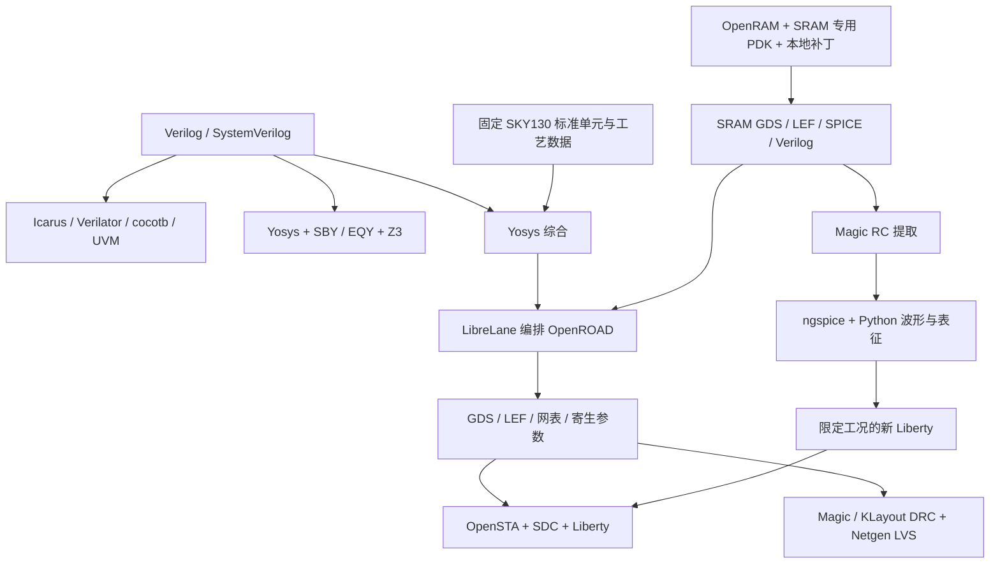

# 本地开源芯片流程：依赖审计与 AIMakeAll 接入

审计日期：2026-11-17（Asia/Shanghai）。来源为聊天“规划开源芯片开发流程”、本地 `~/asic-lab` 脚本、版本查询及历史验收报告。机器实测为 arm64、macOS 27.2.1。历史聊天描述硬件为 M4 Max / 128 GB；本次未重新读取到内存容量，不将其作为本次实测值。

**结论：现有环境可作为 AIMakeAll 的硬件开发与物理实现实验基础，当前最重要的工作是隔离版本、固定来源与接入接口。** QEMU 自定义设备和 AI 推理运行时仍需单独建设。SRAM 已有普通器件版的物理检查成果，但多工况 RC 表征尚未完成。

## 1. 实际部署结构

```text
~/asic-lab -> ~/Documents/ChatGPT/New project/asic-lab
  toolchain -> /nix/store/...-librelane-3.0.17
  tools/librelane-3.0.17/       源码与 flake.lock
  tools/verification-env/      Python 3.12 验证环境
  tools/uvm-env/               独立 Verilator / UVM / macOS 补丁
  tools/openram-env/           OpenRAM / Python / 专用 PDK / 补丁
  tools/magic-rc/              专用于新 RC 提取的 Magic
  pdks/                       数字实现使用的 SKY130 库
  preparation/                PicoRV32、UART、现成 SRAM、IO 与集成模板
  examples/                   原始实验与运行脚本
  results/                    实验报告与交付物
```

路径别名 `~/asic-lab` 有实际作用：真实路径带空格，部分 EDA 启动器不能正确处理。此次直接运行 UVM Verilator 的绝对路径曾失败；按 `uvm-env.sh` 设置 `VERILATOR_ROOT` 和 `VERILATOR_BIN` 后版本查询通过。不要在调用前自动将此别名展开成带空格的真实路径。

## 2. 工具清单与用途

下表“版本可运行”仅表示本次版本查询成功；实验能力依据第 5 节的历史证据，未在本次重跑全部设计。

| 层 | 软件 / 实测版本 | 位置或环境 | AIMakeAll 中的用途 |
| --- | --- | --- | --- |
| 编译基础 | Python 3.11.7、Apple Clang 21.0.0、Make 3.81 | 当前命令环境 | 参考实现、C/C++ 测试台 |
| RTL 仿真 | Icarus 12.0；Verilator 5.044 | Homebrew | 小模块、MAC/阵列、基本 SoC 仿真 |
| UVM 仿真 | Verilator 5.054；UVM 2020.3.1 | `tools/uvm-env` | 总线事务、随机回归和覆盖率；UVM 版本来自锁文件与已有报告 |
| RTL 检查 | Verible v0.0-4300-ga832669d | `tools/verible` | 风格和语法检查 |
| 综合 / 形式验证 | Yosys 0.62、SBY 0.62、EQY 0.62、Z3 4.15.4 | 固定 Nix 环境 | 控制状态机、协议性质、综合前后等价 |
| 默认综合命令 | Yosys 0.60 | 当前 PATH / Homebrew | 与上行不同；不能默认视为同一验证基线 |
| Python 验证 | cocotb 2.1.0、pytest 9.2.0、cocotbext-axi 0.1.28 | `tools/verification-env`，Python 3.12.13 | Python 黄金模型与 RTL 随机对照 |
| 波形查看 | Surfer 0.7.0 | Homebrew | 查看 FST/VCD |
| 固件 | RISC-V GCC 15.1.0 | `riscv64-unknown-elf-gcc` | 裸机驱动与启动程序；已查询到 RV32 multilib |
| 环境固定 | Nix 2.35.4 | `/nix/var/nix/profiles/default/bin` | 保留可复现 EDA 依赖 |
| RTL 到版图 | LibreLane 3.0.17 | `toolchain/bin/librelane` | 将 NPU RTL 扩展到面积/时序/物理实验 |
| 布局布线 | OpenROAD，提交 `dcf36133a369abc8f3c5e5738cd4d82e4903c0e0` | Nix | 布局、时钟树、布线、物理优化 |
| 静态时序 | OpenSTA 2.7.0 | Nix 中 `*-opensta/bin/sta` | Liberty、SDC、寄生参数和时序分析 |
| 物理检查 | Magic 8.3.623 | 固定 Nix 环境 | 基线 DRC、提取与版图实验 |
| 新 SRAM RC | Magic 8.3.703 | `tools/magic-rc` | 当前 SRAM 分布式 R/C 提取；与基线版本分开 |
| LVS / 版图 | Netgen 1.5.316、KLayout 0.30.7 | Nix | 本次确认可执行文件存在；版本按安装目录及旧报告登记，未新启动验收 |
| 电路仿真 | ngspice 47，版本输出确认 KLU | Homebrew | 晶体管功能、RC 后仿、时序/功耗测量 |
| 原理图 | Xschem 3.4.8RC；XQuartz 2.8.6 | `tools/xschem`；X11 | Xschem 版本可运行；XQuartz 版本来自历史安装记录，GUI 本次未重验 |
| SRAM 生成 | OpenRAM 固定提交 | `tools/openram-env/OpenRAM` | 定制存储器、表征；源码与本地修改需一起管理 |
| 数值处理 | NumPy 2.5.5、SciPy 1.18.1、ciel 3.2.0 | OpenRAM Python 3.12.13 环境 | 波形处理、参数扫描、PDK 管理 |
| AI 训练候选 | 当前 Python 的 PyTorch 元数据为 2.14.1、NumPy 2.4.2 | 当前 Python，未建立项目训练环境 | 只确认包元数据，未验证导入、训练、MPS 或数值正确性 |
| 系统模拟缺口 | `qemu-system-riscv32/64` 未在检查位置找到 | 当前 PATH | 需要固定版本、构建依赖、自定义机器与 NPU 模型 |

LibreLane 官方将 Nix 作为主要构建方式，并支持 macOS 原生执行，符合当前已有部署，现阶段适合复用而非重建全局环境。[官方安装说明](https://librelane.readthedocs.io/en/stable/installation/index.html)

## 3. 不能混用的版本和工艺库

### 两套 SKY130

| 用途 | 根目录 | 固定版本 |
| --- | --- | --- |
| 数字实现、标准单元、IO、现成 SRAM | `~/asic-lab/pdks` | `8afc8346a57fe1ab7934ba5a6056ea8b43078e71` |
| 定制 SRAM / 新 RC 表征 | `~/asic-lab/tools/openram-env/pdk` | `e8294524e5f67c533c5d0c3afa0bcc5b2a5fa066` |

`verification-env.sh` 和 `openram-env.sh` 会设置不同的 `PDK_ROOT`。不要在同一长期 shell 中反复覆盖后继续运行；每个实验启动独立进程并记录实际环境。把新 SRAM 接入数字流程前，必须核对工艺层映射、器件模型、供电名称、LEF/GDS、Liberty 工况与接口，不能只把文件路径填进去。

OpenRAM PDK 锁记录包含下载文件 SHA-256，但两个归档的 `digest_verified` 仍为 `false`。这意味着有本地哈希记录，不能写成“已与发布方摘要核验”。后续应补原始发布摘要核验并保存证据。

### 三组执行环境

1. 基础 RTL：Verilator 5.044，可直接复用当前 `make rtl-test`。
2. 进阶验证：Verilator 5.054 + UVM fork + macOS DPI 补丁；Yosys/SBY/EQY 使用固定 0.62 环境。
3. SRAM：OpenRAM 的 Python 与工艺库；原有 Magic 8.3.623 和新提取 Magic 8.3.703 各自保留用途。

不把所有包合并到一个 Python 环境；不因本机默认 Yosys 或 Verilator 能启动，就自动替换已验收版本。

### 固定来源还需要本地修改

| 项目 | 已记录的上游版本 |
| --- | --- |
| PicoRV32 | `ef203c2b0a3fb793280f5114941416c425c5b461` |
| OpenRAM | `2f7b3866418ac1ce17ad959207a1489033d8c577` |
| OpenRAM SRAM 基础单元 | `fc63b12883b4bf458ee8c756ba64c37063e1ffb9` |
| UVM 用 Verilator | `bbb60a403932a9f695cb6ff001ceb73de6ad9234` |
| UVM fork | `656f20d087370a7c742e00188d20bbf30fa95339` |
| LibreLane 的 nix-eda | `8f990fb77529c09e540e453cd836af9930ec58db` |
| LibreLane 的 nixpkgs | `b3aad468604d3e488d627c0b43984eb60e75e782` |

UVM 有 `macos-dpi.patch`；OpenRAM 有 `ngspice-runtime.patch`（包括运行目录、SkyWater 兼容配置及 KLU）以及后续 SRAM 电路/版图修正。OpenRAM 当前为源码归档展开，未发现 `.git`；仅下载同一上游提交不能重现所有修复。迁移前需与原始归档比较，整理完整补丁及补丁应用测试。

`flake.lock` 固定依赖图，但复制一个锁文件并不能替代对应 LibreLane 源码、Nix 表达式和补丁。本次只记录哈希，不伪装成已经提供一键重装能力。Magic RC 的精确源码来源与本地补丁也应在迁移前补齐。

## 4. 全流程依赖关系



这是能力依赖图，不代表 AIMakeAll NPU 已跑通上述链路。QEMU 走另外的软件路径：RISC-V GCC → guest 固件 → QEMU 机器/设备 → 数学参考后端。QEMU 不依赖 GDS、PDK 或 SRAM 的 SPICE 网表，也不能由这些文件自动生成加速器模型。[QEMU RISC-V 机器说明](https://www.qemu.org/docs/master/system/target-riscv.html)

## 5. 已有成果与当前边界

| 实验 | 本地历史证据 | 对本项目的价值 / 边界 |
| --- | --- | --- |
| PWM RTL → GDS | `logs/status.json`：仿真通过，时序、DRC、LVS、天线检查计数为零 | 可复用物理流程模板；这是模块，不是带 pad ring 的完整 SoC |
| APB PWM | `logs/verification-status.json`：完整入口退出 0 | lint、cocotb、formal、equivalence、负例与物理流程的教学起点 |
| PicoRV32 裸机 | `preparation/status.json`：CPU C 固件通过 | 使用行为 RAM；UART 仅编译，尚未接入真实 SRAM 或 AIMakeAll NPU |
| 现成 1 KB SRAM | preparation 报告：地址、双口、字节掩码与库视图检查通过 | 可作为候选存储宏；现有 Liberty 只覆盖 TT / 1.8 V / 25°C |
| UVM 跨域邮箱 | `results/uvm_cdc/results.json`：8/8 回归，含三个负例 | 可复用验证方法；CDC/RDC 为该设计专用检查，覆盖率只代表本例 |
| 数模联合 | `results/mixed_signal/results.json`：三个正常例与断反馈负例满足预期 | 可选扩展；并非 NPU 必需项，也不是完整 Verilog-AMS 签核 |
| 普通器件 SRAM | `results/openram_generic/results.json`：16×8、1RW1R；DRC 0、严格 LVS；1792 位电路检查与 32 位器件提取检查通过 | 可作为存储单元课程；旧库不适用于新宏，以上功能记录未包含连线 RC |
| SRAM RC 表征 | 本次读取 `results/openram_pex/acceptance.json` 为 `INCOMPLETE`，`characterization_ready=false` | RC 网表与部分检查已完成，不能发布为通过的多工况库 |

本次快照中，PEX 的待完成项包括 SS/FF 静态待机功耗、数值收敛和双端口功耗包络。已记录的原始提取规模为 26,510 个 R、51,857 个 C、4,118 个器件实例。另一个聊天仍在工作，因此这里是时间点快照，不能用它覆盖后续结果。

新版定制 SRAM 总容量仅 **128 bit = 16 byte**。它适合学习和验证单元/编译流程，不足以存储 LLM 权重，也不能直接满足 NPU scratchpad。需要另做容量、bank、端口带宽和面积预算。首版功能仿真可先采用行为内存，待宏验收后再做物理替换。

本地 DRC/LVS 清零也不等于制造项目验收；SKY130 官方仍说明其开放 PDK 的实验性状态，具体交付按选定制造项目要求核验。[官方状态说明](https://skywater-pdk.readthedocs.io/en/main/status.html)

## 6. 如何并入四阶段项目

| AIMakeAll 阶段 | 直接复用 | 尚需补齐 |
| --- | --- | --- |
| RISC-V + NPU | 仿真、cocotb/UVM、综合、形式验证、RISC-V GCC、物理流程 | NPU 阵列、总线/驱动、内存与中断；SoC 级验证；宏集成 |
| QEMU Simulator | GCC、裸机测试向量、MMIO 规范、Python 参考 | QEMU 固定版本与构建依赖核验、机器模型、设备回调、guest 测试 |
| 从零 LLM | 当前 PyTorch 可作为环境评估起点 | 独立训练环境与锁文件、数据许可、模型实现、INT8 导出与运行时 |
| Agent | 项目记录与测试报告可作为受限查询工具的数据 | 模型工具调用、执行循环、权限边界、端到端评测 |

现有 PicoRV32 已有固定源码与裸机证据，而本项目原计划选择 Ibex。建议把 PicoRV32 作为早期总线/NPU 联调候选，以减少启动工作；**本次不更改 CPU 主线**。正式选择时比较 ISA（现有测试为 RV32I）、总线接口、中断、乘除法需求、软件 ABI 和物理代价，再做架构决策。两种 CPU 都应通过同一 GEMM 软件接口。

## 7. 接入次序与完成标准

1. **已完成：环境资产登记。** 新增只读检查器与本次 JSON 快照，记录工具版本、环境隔离和证据哈希；未复制外部源码或大型产物。
2. **接下来：迁移一个轻量验证实验。** 优先 APB/cocotb 或 PicoRV32 固件案例，核对许可、移除用户绝对路径、固定源码和补丁；从 AIMakeAll 一条命令重现结果才标记“已迁移”。
3. **接入 NPU 阵列。** Python 与 RTL 随机对照，加入总线读写和超时测试，再尝试综合/布局布线。面积和时序必须基于真实 NPU RTL。
4. **接入 SRAM。** 等待新宏 RC/PVT/Liberty 验收完成；核对所有视图的哈希及适用版本，完成读延时、字节掩码、供电和时钟适配。先单宏再多 bank。
5. **补 QEMU 与训练环境。** QEMU 需要核验 C 编译器、Python、Meson/Ninja、pkg-config、GLib 等所选版本的构建要求；此轮未做完整构建依赖审计，不将安装单个主程序当作设备集成完成。

主仓库保存原创讲解、可移植配置、脚本、源码锁、补丁与小型测试数据。工具二进制、Nix store、PDK、波形、GDS 和大规模表征中间结果留在外部目录或带校验和的发布附件中。第三方源码按各自许可引入，不能套用仓库 MIT 许可。

## 8. 使用方式与资源

在 AIMakeAll 根目录运行：

```sh
make eda-doctor
```

输出为 `build/eda-environment.json`，命令仅盘点；详细语义见 [检查器说明](../tools/eda/README.md)。当前源码保留已知版本的 Nix 路径模式，多候选时会报告歧义而非猜选。日后换机器需更新路径配置。

需要手动进入原环境时，每次使用独立 bash。例如：

```sh
bash -c 'source "$HOME/asic-lab/verification-env.sh"; yosys -V; sby --version'
bash -c 'source "$HOME/asic-lab/uvm-env.sh"; verilator --version'
bash -c 'source "$HOME/asic-lab/openram-env.sh"; python --version; ngspice --version'
```

这些命令已按本机入口检查，非完整新机安装步骤。原 `openram-pex.sh status` 会刷新报告，有写入行为，因此盘点脚本只读 JSON，不调用它，也不启动或干预另一个聊天的长任务。

本次 `du -sk` 统计：tools、pdks、results、examples、preparation、logs 合计约 **3.16 GiB**；共享 `/nix/store` 约 **3.86 GiB**。这不是未来安装所需空间估计，也未包括缓存、临时目录及所有其他文件；正在进行的仿真会改变占用。Nix store 属于共享资产，不全部归算为本项目增量。完整 RC 表征已有单项约三小时的记录，主项目常规测试不应自动触发整套 SRAM 表征。

## 9. 证据索引

- 本次可机器读取的固定快照：[local-eda-2026-11-17.json](environment/local-eda-2026-11-17.json)。
- 原实验入口：`~/asic-lab/lab.sh`、`apb-lab.sh`、`uvm-lab.sh`、`postlayout-lab.sh`、`mixed-signal-lab.sh`、`openram-generic.sh`、`openram-pex.sh`。
- 原始来源记录：LibreLane `flake.lock`；`tools/openram-env/sources/*.lock.json`；`tools/uvm-env/sources/sources.lock.json`；`preparation/sources/downloads.lock.json`。
- 本次只读审计不证明源码无修改，也不证明现有全部二进制可从上游重新构建；这些是下一轮环境可移植化的验收项。
