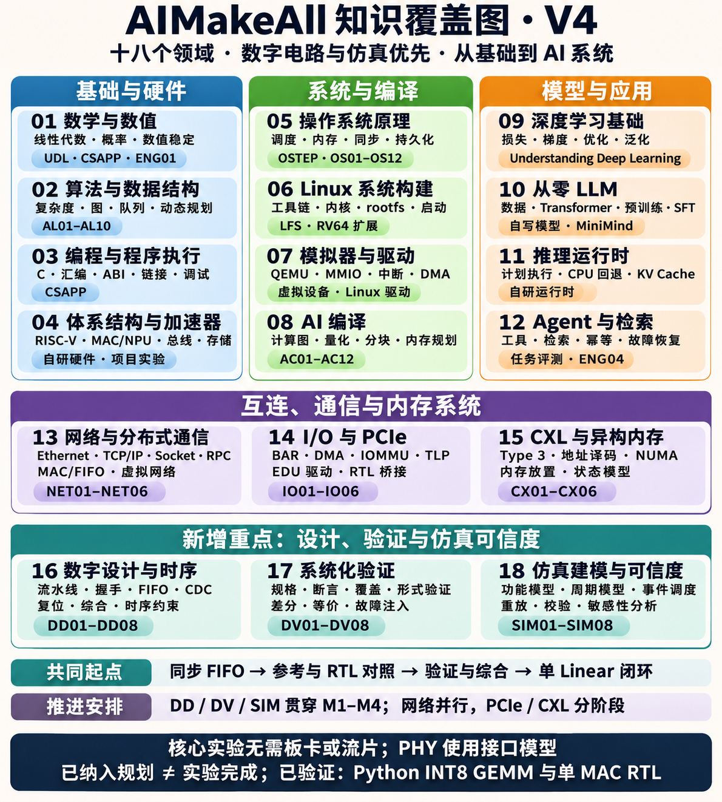

# AIMakeAll 全景规划图

更新：2026-11-17。状态以本项目记录为准；外部实验成果不等于已经接入本项目，资料规划不等于功能实现。

交付遵循 [仿真优先原则](SIMULATION_FIRST.md)：数字 RTL → 仿真 → 综合，系统与协议使用 QEMU/事务模型；可选数字物理设计仍在电脑内完成。核心验收不要求板卡或流片。

## 知识覆盖范围

这张图按十八个知识领域展示范围。V4 在原有算法、系统、模型与互连体系上，补入 DD 数字设计、DV 系统化验证和 SIM 仿真可信度；三条课程共用同步 FIFO，再贯穿单 Linear 和系统扩展。四个工程专项继续汇总数值、数据、性能和检索验收。覆盖范围不等于已完成实验。查看 [原图](images/knowledge-coverage-v4.png)、[文字索引](KNOWLEDGE_COVERAGE.md) 或下方实施依赖。

## 项目实施依赖

```mermaid
flowchart TB
    ROOT[AIMakeAll<br/>中文教材 + 开源实现 + 实验与验收]

    subgraph FOUNDATION[共同基础]
        ALG[算法 AL01–AL10<br/>复杂度、容器、图与调度]
        OS[OSTEP OS01–OS12<br/>调度、内存、并发与持久化]
        CS[CSAPP 全书体系已映射<br/>CS01–CS12 实验待实现]
        LFS[Linux From Scratch<br/>11 章与附录已映射，实验待实现]
        UDL[Understanding Deep Learning<br/>21 章与附录已映射，实验待实现]
        U1[模型核心<br/>表达、损失、梯度、优化、残差与注意力]
        U2[评估与能力边界<br/>泛化、消融、伦理；RL 后续扩展]
        U3[广度选修<br/>CNN、GNN、生成模型]
        C1[第 1–6 章<br/>数值、机器代码、处理器、性能、存储]
        C2[第 7–9 章<br/>链接、异常控制流、虚拟内存]
        C3[第 10–12 章<br/>I/O、网络、并发]
        EDA[外部已有 EDA 实验基础<br/>工具统一方案待实施]
        SPEC[项目已有数值规范与接口草案<br/>GEMM、MMIO、布局与错误语义]
        CS --> C1
        CS --> C2
        CS --> C3
        UDL --> U1
        UDL --> U2
        UDL --> U3
    end

    ROOT --> CS
    ROOT --> ALG
    ROOT --> OS
    ROOT --> LFS
    ROOT --> UDL
    ROOT --> EDA
    ROOT --> SPEC

    subgraph METHODS[设计、验证与仿真方法 · 实验待实现]
        DD[DD01–DD08<br/>流水线、握手、FIFO、复位、CDC 与时序]
        DV[DV01–DV08<br/>规格、参考、断言、覆盖、形式与故障]
        SCM[SIM01–SIM08<br/>事件、周期、重放、校验与敏感性]
        FIFO[G0 / G1 共同起点<br/>固定同步 FIFO 契约、模型、RTL 与证据]
        EVID[G2 / G3 证据报告<br/>正确性、支持范围、时间模型与可信度]
        DD --> FIFO
        DV --> FIFO
        SCM --> FIFO
        FIFO --> EVID
    end

    ROOT --> DD
    ROOT --> DV
    ROOT --> SCM
    SPEC -.数值与接口约束.-> DV

    subgraph HARDWARE[M1 · RISC-V + NPU]
        MAC[已验证：Python GEMM 与单 MAC]
        ARRAY[下一步：4×4 阵列<br/>分块、局部存储、随机对照]
        SOC[RISC-V + 总线 + NPU + 驱动]
        PHYS[扩展：综合、布局布线、SRAM 接入<br/>电脑内物理设计；实物独立可选]
        MAC --> ARRAY --> SOC --> PHYS
    end

    C1 --> ARRAY
    FIFO -.复用握手与验证方法.-> ARRAY
    SPEC --> MAC
    EDA -.验证与物理基础.-> PHYS

    subgraph SIM[M2 · QEMU 与软件运行时]
        QEMU[RISC-V 虚拟平台与自定义 NPU 设备]
        RT[C 运行时<br/>CPU / NPU 后端与错误处理]
        QEMU --> RT
    end

    C2 --> QEMU
    OS -.内存与请求生命周期.-> RT
    SPEC --> QEMU
    SCM -.时间与重放契约.-> QEMU
    DV -.需求与测试追溯.-> QEMU
    SOC -.共同 ABI 与向量.-> QEMU

    subgraph CONNECT[互连、通信与内存系统 · 实验待实现]
        IOBASE[S0 · IO01 片内互连<br/>MMIO 闭环、握手与访问边界]
        PCIBASE[S1 · IO02–IO04<br/>Linux EDU、BAR、DMA 与中断]
        PCINPU[S1 · IO05<br/>虚拟 PCIe NPU 与独立传输 ABI]
        NETBASE[S2 · NET01–NET04 · 可并行<br/>网络协议、双节点 CPU 服务与故障]
        NETAPP[S2 · NET05<br/>远程推理与 Agent，设备后端另验]
        CXL[S3 · CX01–CX05<br/>独立 q35 / Type 3 内存与放置]
        ADV[进阶 IO06 / NET06 / CX06<br/>PCIe RTL、软件 RDMA、CXL 状态模型]
        IOBASE -.学习顺序.-> PCIBASE
        PCIBASE --> PCINPU
        PCIBASE -.PCI 与内存基础.-> CXL
        NETBASE --> NETAPP
        PCINPU -.可选远程 NPU 后端.-> NETAPP
        PCINPU --> ADV
        CXL --> ADV
        NETAPP --> ADV
    end

    SOC -.S0 验收.-> IOBASE
    C3 --> NETBASE
    OS -.并发与恢复.-> NETBASE
    OS -.内存原理.-> CXL
    ROOT --> CONNECT
    DD -.数字子模块.-> ADV
    DV -.协议与故障验收.-> ADV
    SCM -.模型边界与校验.-> ADV

    subgraph LINUX[系统扩展 · Linux 构建与服务，待实施]
        LXBASE[Linux x86-64 环境复现 LFS<br/>工具链 → 用户态 → 内核与启动]
        LXRV[独立 RV64 QEMU Linux<br/>固件、设备树与 rootfs 适配]
        LXDRV[Linux NPU 驱动<br/>缓冲区、用户接口与错误回收]
        LXSVC[推理与工具服务<br/>启动依赖、权限、日志与重启]
        LXBASE -.构建方法迁移.-> LXRV
        LXRV --> LXDRV --> LXSVC
    end

    LFS --> LXBASE
    OS -.系统机制.-> LXBASE
    C2 -.系统原理.-> LXBASE
    SPEC -.数值与设备语义.-> LXDRV
    LXDRV -.Linux 后端.-> RT
    LXRV -.独立 Linux PCIe 环境.-> PCINPU
    PCINPU -.设备后端.-> RT

    subgraph MODEL[M3 · 从零 LLM 与 MiniMind]
        LEARN[自写小模型 + MiniMind 参考<br/>资料已纳入，训练待实施]
        TRAIN[数据与 tokenizer → 预训练 → SFT<br/>随机权重、独立验证集]
        LEARN --> TRAIN
    end

    subgraph COMPILE[AI 编译 AC01–AC12 · 待实现]
        GRAPH[有限计算图<br/>依赖、形状、类型检查]
        QUANT[FP32 基线 → INT8 量化<br/>权重布局、scale 与校准规则]
        TILE[布局与 GEMM 分块<br/>K 部分和、CPU 回退]
        MEMORY[生命周期与缓冲区规划]
        PLAN[执行计划与模型包<br/>先单 Linear，再扩展模型]
        GRAPH --> QUANT --> TILE --> MEMORY --> PLAN
    end

    TRAIN --> GRAPH
    ALG --> GRAPH

    C1 --> LEARN
    U1 --> LEARN
    U1 --> TRAIN
    C2 -.内存与加载.-> QUANT
    DEPLOY[模型推理闭环<br/>CPU / QEMU / RTL 数值对照<br/>prefill 与 decode 分开评测]
    PLAN --> DEPLOY
    RT --> DEPLOY
    EVID -.G2 验收.-> DEPLOY
    CXL -.CPU 模型内存放置扩展.-> DEPLOY
    SOC -.硬件对照.-> DEPLOY
    U2 -.质量评估.-> DEPLOY
    U3 -.后续算子负载.-> ARRAY

    subgraph AGENT[M4 · Agent 与服务]
        TOOL[受限工具、协议、进程与并发<br/>计算、检索、实验结果查询]
        APP[自训练模型决策 + 工具执行<br/>加速后端接入与独立任务评测]
        TOOL --> APP
    end

    C3 --> TOOL
    ALG -.索引与任务队列.-> TOOL
    OS -.并发与恢复.-> TOOL
    C2 -.异常与取消.-> TOOL
    DEPLOY --> APP
    NETAPP -.远程服务扩展.-> APP
    U2 --> APP
    LXSVC -.后续部署环境.-> APP
    APP --> DONE[最终交付<br/>教材、源码、可复现实验与结果<br/>数值 / 质量 / 性能 / 任务成功率]
    PHYS -.物理验收证据.-> DONE
    EVID -.G3 分层证据.-> DONE
    ENG[四个工程专项 · 实验待实现<br/>数值量化、数据训练、性能验证、检索可靠性]
    ROOT --> ENG
    ENG -.贯穿 M1–M4 的验收.-> DONE
```

## 下一步与并行关系

1. DD/DV/SIM 先共用 G0/G1 同步 FIFO，形成接口、参考、RTL、覆盖、故障与重放模板；并行推进 4×4 阵列，结合 CS02/CS04/CS06 和 ENG03 学习数值、控制、存储与验证。
2. 软件并行做 AL07 计算图检查、C 整数参考和单线性层的量化/分块计划；先有可检查的计划解释器，再考虑 MLIR。
3. 围绕 GEMM/MMIO 建立 QEMU 设备与运行时，打通单线性层的 CPU/QEMU/RTL 对照；ENG01/ENG03 分别验收数值和性能。
4. UDL 与 MiniMind 小模型训练可并行，先补 ENG02 数据与恢复实验；模型成熟后复用同一编译与运行时路径。
5. Agent 接入 AL04/AL06 的索引和队列、OSTEP 的并发与持久化、ENG04 的检索和故障评估。
6. LFS/RV64 Linux 按独立系统扩展推进；OSTEP 原理实验不等待完整 LFS，Linux 扩展也不阻塞 RV32 裸机闭环。
7. IO01 随主线补片内访问与握手；IO02–IO05 用独立 Linux 环境从 EDU 进入 PCIe NPU。NET01–NET04 可先用 CPU 服务并行，NET05 再接模型、Agent 与已验收的设备后端。
8. CXL 在 PCI/Linux 内存基础之后，以独立 x86-64 q35 + Type 3 起步；先容量和放置，再研究 NPU 可寻址性、Type 2 或多设备。网络补帧级 MAC/FIFO/CRC 数字实验，PCIe 补事务模型与可综合桥接，CXL 补译码/队列 RTL；软件 RDMA 和一致性模型为进阶，实物不作前置。

SRAM 与物理实现为扩展线，其状态需独立核验；早期功能实验可使用行为内存。QEMU 功能模拟、宿主机提速和真实硬件加速分开报告。

[G0–G3](ROADMAP.md) 是各阶段的证据门槛：契约 → FIFO → 单 Linear → 系统扩展。单时钟主线不等待 DD06 异步 FIFO 或 SIM08 实时联仿；工具尚未支持或尚未跑通的检查保留未验证状态。

## 详细路线

- [知识覆盖文字索引](KNOWLEDGE_COVERAGE.md)
- [数字设计 DD01–DD08](DIGITAL_DESIGN_TIMING.md) · [系统化验证 DV01–DV08](SYSTEMATIC_VERIFICATION.md) · [仿真可信度 SIM01–SIM08](SIMULATION_CREDIBILITY.md)
- [算法与数据结构](ALGORITHMS_FOUNDATIONS.md) · [OSTEP 操作系统原理](OSTEP_FOUNDATIONS.md)
- [AI 编译与单线性层贯通实验](AI_COMPILATION.md) · [四个工程专项](ENGINEERING_BRIDGES.md)
- [网络 NET01–NET06](NETWORKING_FOUNDATIONS.md) · [I/O 与 PCIe IO01–IO06](PCIE_IO_FOUNDATIONS.md) · [CXL CX01–CX06](CXL_MEMORY_FOUNDATIONS.md)
- [CSAPP 全书知识体系与项目实验](CSAPP_FOUNDATIONS.md)
- [Linux From Scratch 知识体系与系统扩展](LFS_FOUNDATIONS.md)
- [Understanding Deep Learning 知识体系与项目实验](UDL_FOUNDATIONS.md)
- [课程目录](CURRICULUM.md) · [里程碑](ROADMAP.md) · [系统架构](ARCHITECTURE.md)
- [本地 EDA 环境](LOCAL_EDA_ENVIRONMENT.md) · [工具统一方案](EDA_TOOLCHAIN_CONSOLIDATION.md)
- [MiniMind 学习与部署](MINIMIND_INTEGRATION.md)
