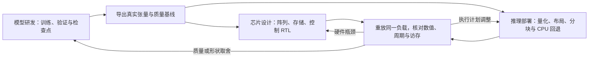
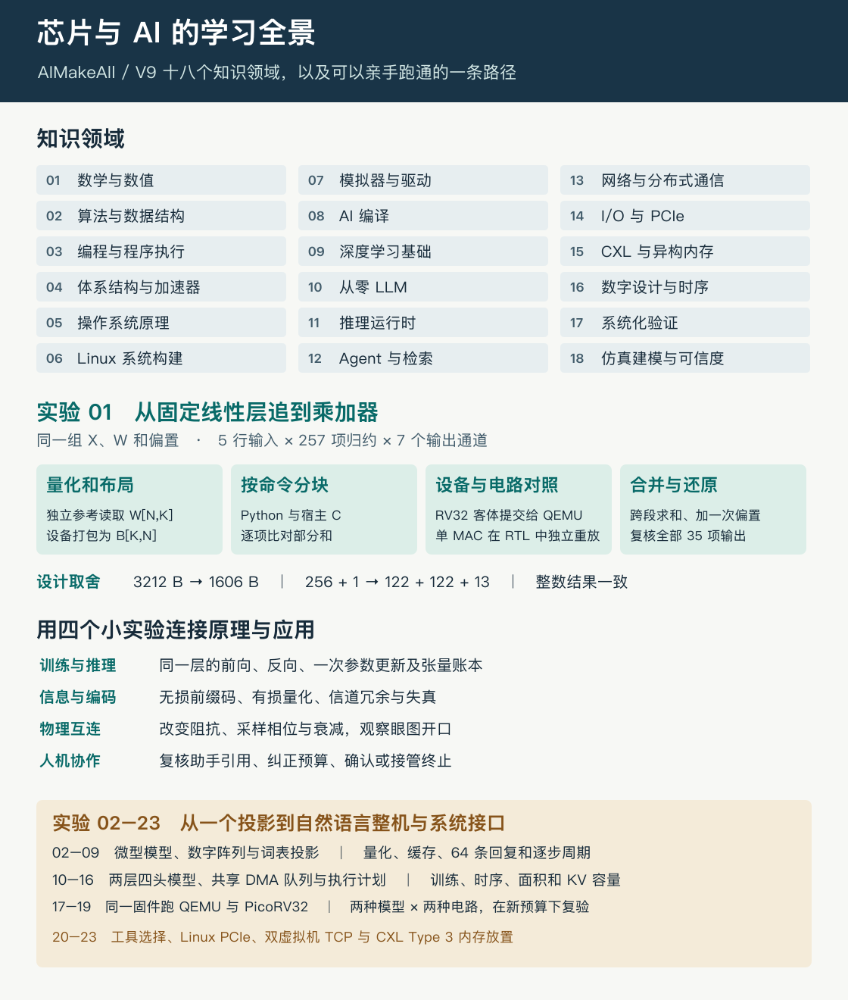

# AIMakeAll 全景规划图

更新：2026-11-18。状态以 [课程状态总表](CURRICULUM.md#课程状态总表) 及对应验证记录为准；外部实验成果不等于已经接入本项目，资料规划不等于功能实现。

交付遵循 [仿真优先原则](SIMULATION_FIRST.md)：数字 RTL → 仿真 → 综合，系统与协议使用 QEMU/事务模型；可选数字物理设计仍在电脑内完成。核心验收不要求板卡或流片。

## 个人如何贯通三项能力

一个人沿图提交三份可复查的产物：可综合的 NPU、自训练的模型检查点、可生成结果的推理程序。给定新输入或更紧的内存预算后，用实验判断应该改哪一层。[个人毕业任务](CHIP_MODEL_PLAN.md#个人毕业任务)

## 芯模联动的实验与验收

项目以可综合数字 NPU 为设计对象，以小型 Transformer 为目标负载。学习者要能从一层模型提出一项硬件需求，也要能从一段 RTL 轨迹指出模型或映射方案值得调整的地方。以下为联合实验的交付目标。

| 步骤 | 要回答的问题 | 交付与验收 |
| --- | --- | --- |
| 从模型得到芯片规格 | 在提示词处理和逐 token 生成两种场景中，一个已训练模型的同一前馈层分别处理什么形状？权重和激活搬运多少字节？ | 冻结模型检查点、输入、质量基线及预算。导出张量、量化尺度、逐层参考和两种场景的形状，将它们转为精度、并行度和片上缓冲需求 |
| 实现数字处理器 | 乘加单元怎样组成阵列？权重怎样复用？下游暂停时谁保存部分和？ | 实现阵列、局部存储接口、地址生成与控制 RTL。在复位、背压和尾块下与独立整数参考逐项核对，保存波形、周期和综合结果 |
| 用模型比较硬件 | 增加计算单元或提高片上存储带宽，哪项能缓解当前模型层的瓶颈？ | 固定模型、输入、时钟约束和外存假设，每次改变一个硬件参数。比较有效 MAC 占比、停顿周期与跨存储边界的字节数。面积比较使用同一目标库 |
| 用硬件反馈调整模型 | 如果权重搬运主导逐 token 生成，缩小前馈层宽度是否值得？ | 固定硬件、数据划分和训练预算，重新训练候选宽度的模型并导出。用同一验证集比较困惑度，用同一 RTL 重放新形状，比较周期和字节数。依预先约定的质量门槛决定是否采用 |

**当前可以做到代表层的联合设计。** 实验 01 用固定 Linear 把 RV32/QEMU 和独立单 MAC 的整数结果对齐。实验 02 用随机初始化后训练的两个微型 Transformer 对照两套 4×4 阵列，测量模型质量、局部访存和提示词／生成两种投影的周期。实验 03 已用同一份裸机程序在 QEMU 与 PicoRV32 RTL 生成符号，保留每步模型、总线和设备证据。实验 04 用同一台 PicoRV32 对照纯 CPU 和 NPU，分别量到提示词收益与单行开销。实验 05 追踪权重缓冲的实际写入，用两次重复请求复验预打包的回本点。实验 06 已验证单槽权重缓存随运行时模型切换而重建，坏包在提交前被拒绝。实验 07 已在同一固件比较融合 Q/K/V 的三种后端，并量到包校验、热命中与整步生成的成本。[实验 07](../labs/07-fused-qkv/README.md) · [实验 06](../labs/06-model-switch/README.md) · [实验 05](../labs/05-weight-prepack/README.md) · [实验 04 与试读入口](../labs/04-rv32-performance/README.md) · [实验 01](../labs/01-linear257/README.md) · [实验 02](../labs/02-trained-projection/README.md) · [实施顺序](ROADMAP.md)

[实验 03 学生手册](../labs/03-rv32-generation/README.md) · [阶段验收](ROADMAP.md#实验-03-从设备命令追到生成符号)

## 知识覆盖范围

V9 沿用十八个知识领域、十条全景路线和六项跨层补强，保留实时系统、多模态与表示学习、因果推断，以及从需求出发的综合设计实验。查看 [原图](images/knowledge-coverage-v9.png)、[文字索引](KNOWLEDGE_COVERAGE.md) 和 [完整课程与验收](CHIP_AI_COMPLETENESS.md)。

原十组 60 项、十路线 30 个节点、六项 18 个节点与三门专题 9 个节点、综合实验 4 个检查点存在复用。个人可以按 00 手算乘加、01 调试设备分块、02 用训练权重选电路与模型的顺序学习，再进入 SoC、自然语言模型及应用选修。

## 读图时可以先走这条路

从实验 00 的一个乘加开始，在实验 01 预测两次命令的部分和。分别运行宿主 C、QEMU 中的 RV32 客体和 Verilator 中的单 MAC。回到模型后检查误差，再把缓冲预算减半并重做决策。个人可以先在软件段完成手算、排错与训练对照，设备实践排在第二次学习。每个阶段的命令、出口和需保留的报告见[学习者手册](../labs/01-linear257/README.md)。

## 项目实施依赖

```mermaid
flowchart TB
    ROOT[AIMakeAll<br/>数字 NPU 与 AI 模型协同设计]

    subgraph FOUNDATION[共同基础]
        ALG[算法 AL01–AL10<br/>复杂度、容器、图与调度]
        OS[OSTEP OS01–OS12<br/>调度、内存、并发与持久化]
        CS[CSAPP 全书体系已映射<br/>CS01–CS12 实验待实现]
        LFS[Linux From Scratch<br/>11 章与附录已映射，实验待实现]
        UDL[Understanding Deep Learning<br/>21 章与附录 + MATH-E1–E6 数学基础]
        U1[模型核心<br/>表达、损失、梯度、优化、残差与注意力]
        U2[评估与能力边界<br/>泛化、消融、伦理；RL 后续扩展]
        U3[广度选修<br/>CNN、GNN、生成模型]
        C1[第 1–6 章<br/>数值、机器代码、处理器、性能、存储]
        C2[第 7–9 章<br/>链接、异常控制流、虚拟内存]
        C3[第 10–12 章<br/>I/O、网络、并发]
        EDA[外部已有 EDA 实验基础<br/>工具统一方案待实施]
        SPEC[项目已有数值规范与接口草案<br/>GEMM、MMIO、布局与错误语义]
        CS --> C1
        CS --> C2
        CS --> C3
        UDL --> U1
        UDL --> U2
        UDL --> U3
    end

    ROOT --> CS
    ROOT --> ALG
    ROOT --> OS
    ROOT --> LFS
    ROOT --> UDL
    ROOT --> EDA
    ROOT --> SPEC

    subgraph BREADTH[全景补全 · 全部待实施]
        SIG[SIG 数学与信号系统<br/>方程、采样、状态空间]
        CIR[CIR 电路与半导体器件<br/>MOS、CMOS、寄生与噪声]
        HET[HET CPU / GPU / DSP<br/>执行模型与数据流对照]
        CHIP[CHIP 物理与产品流程<br/>供电、测试、封装、良率模型]
        CLA[CLA 经典机器学习与 AI<br/>树、核、逻辑、概率与规划]
        DLE[DLE 推导与模型比较<br/>梯度、结构性质、生成模型]
        EMB[EMB 感知估计与控制<br/>视觉、音频、二维机器人]
        SCALE[SCALE 规模工程<br/>训练、分片、服务与恢复]
        SIG --> CIR --> CHIP
        SIG --> EMB
        CLA --> EMB
        DLE --> EMB
    end
    ROOT --> SIG
    ALG --> CLA
    UDL --> DLE
    ROOT --> HET
    ROOT --> SCALE

    subgraph STRENGTH[六项跨层补强 · 实验待实施]
        LIFE[LIFE SoC 生命周期<br/>启动、休眠唤醒、恢复与调试]
        TRUST[TRUST 硬件到模型信任链<br/>认证、授权、防回滚与更新]
        SHIFT[SHIFT 数据变化可靠性<br/>校准、拒答、监测与再验收]
        SELECT[SELECT AI 方法比较<br/>共同任务、多策略与成本]
        LIMIT[LIMIT 理论边界<br/>可计算、高效、学习与证明]
        MIX[MIX 混合信号系统角色<br/>模拟前端、转换、时钟与误差]
        LIFE -.启动与恢复契约.-> TRUST
    end
    ROOT --> STRENGTH
    ALG -.复杂度与命题.-> LIMIT
    SIG --> MIX
    CIR --> MIX
    MIX -.信号到任务.-> EMB
    CLA --> SELECT
    DLE --> SELECT
    DLE --> SHIFT

    subgraph EXTENSIONS[实时 多模态 因果与综合设计 · 单层预算已运行]
        RTCOURSE[RT 实时系统<br/>调度、阻塞、控制与推理分层]
        MM[MM 多模态与表示学习<br/>配对、对齐、融合与部署]
        CAUSE[CAUSE 因果推断<br/>干预、识别、反事实与决策]
        DESIGN[DESIGN 综合实验<br/>需求 → 候选 → 证据 → 取舍与迁移]
    end
    OS --> RTCOURSE
    RTCOURSE -.时限与数据年龄.-> EMB
    DLE --> MM
    MM -.跨模态检索.-> APP
    CLA --> CAUSE
    CAUSE -.模拟决策.-> APP
    ROOT -.G0 冻结需求.-> DESIGN
    SELECT -.方法与质量.-> DESIGN
    EVID -.分层验证.-> DESIGN
    SOC -.周期与资源.-> DESIGN
    RTCOURSE -.按需时限合同.-> DESIGN
    MM -.按需模态需求.-> DESIGN
    CAUSE -.按需干预目标.-> DESIGN

    subgraph METHODS[设计、验证与仿真方法 · 实验待实现]
        DD[DD01–DD08 + PPA / ARITH<br/>数字设计、算术结构、时序与面积能耗]
        DV[DV01–DV08 + SW-E1–E6<br/>验证、软件正确性与可复现工程]
        SCM[SIM01–SIM08<br/>事件、周期、重放、校验与敏感性]
        FIFO[G0 / G1 共同起点<br/>PRA-1/2 同步 FIFO、调试、综合与证据]
        EVID[G2 / G3 证据报告<br/>DEP 单 Linear 对照、扩展与可信度]
        ARITH[ARITH-E1–E6 · 待实现<br/>位宽 → 加法器/乘法器 → 定点与 MAC]
        RAS[RAS-E1–E6 · 待实现<br/>校验/ECC → 受保护存储 → 故障处置]
        DD --> FIFO
        DV --> FIFO
        SCM --> FIFO
        FIFO --> EVID
        DD --> ARITH
        DV --> RAS
        ARITH -.数值与事务对照.-> EVID
        RAS -.G3 错误与恢复证据.-> EVID
    end

    ROOT --> DD
    ROOT --> DV
    ROOT --> SCM
    SPEC -.数值与接口约束.-> DV

    subgraph HARDWARE[M1 · RISC-V + NPU]
        MAC[已验证：Python GEMM 与单 MAC]
        ARRAY[已运行：4×4 阵列<br/>共享读与 A/B 分库，256 B 局部存储]
        SOC[RISC-V + 总线 + NPU + 驱动<br/>MEM-E 事务、仲裁与存储模型扩展]
        PHYS[扩展：综合、布局布线、SRAM 接入<br/>电脑内物理设计；实物独立可选]
        MAC --> ARRAY --> SOC --> PHYS
    end

    C1 --> ARRAY
    ARITH -.候选结构经验证后接入.-> ARRAY
    SOC -.存储接口具备后扩展.-> RAS
    FIFO -.复用握手与验证方法.-> ARRAY
    SPEC --> MAC
    EDA -.验证与物理基础.-> PHYS
    DD -.复位与状态机.-> LIFE
    LIFE -.平台管理扩展.-> SOC
    LIMIT -.假设与证明范围.-> DV
    CIR -.器件与负载基础.-> DD
    DD -.已验模块.-> CHIP
    CHIP -.电脑内物理实验.-> PHYS
    HET -.架构对照.-> ARRAY

    subgraph SIM[M2 · QEMU 与软件运行时]
        QEMU[RISC-V 虚拟平台与自定义 NPU 设备]
        RT[C 运行时<br/>SW-E 正确性与 PERF-E 性能基准]
        QEMU --> RT
    end

    C2 --> QEMU
    OS -.内存与请求生命周期.-> RT
    SPEC --> QEMU
    SCM -.时间与重放契约.-> QEMU
    DV -.需求与测试追溯.-> QEMU
    SOC -.共同 ABI 与向量.-> QEMU
    DV -.SW-E 软件与复现证据.-> RT

    CASE[实验 01 · 已运行<br/>固定 Linear · 两种预算 · 35 项输出]
    MAC -.逐点积重放.-> CASE
    QEMU -.RV32 裸机 MMIO.-> CASE
    CASE -.单层预算证据.-> DESIGN
    PROJ[实验 02 · 已运行<br/>两种模型宽度与两种存储，比较质量与周期]
    CASE -.布局与整数契约.-> PROJ
    ARRAY --> PROJ
    LEARN -.自训练权重.-> PROJ
    GEN03[实验 03 · 已运行<br/>同一固件完成训练投影与四步生成]
    GEN03 --> PERF04[实验 04 · 已运行<br/>同一 PicoRV32 对照提示词与逐符号周期]
    PERF04 --> PACK05[实验 05 · 已运行<br/>预打包的首次成本、每步周期与回本次数]
    PACK05 --> LOAD06[实验 06 · 已运行<br/>同一固件切换模型、核对尺度与拒绝坏包]
    LOAD06 --> QKV07[实验 07 · 已运行<br/>融合 Q/K/V、量化质量与完整请求周期]
    PROJ --> GEN03
    QEMU -.功能设备.-> GEN03
    SOC -.PicoRV32 微块接口.-> GEN03

    subgraph CONNECT[互连、通信与内存系统 · 实验待实现]
        IOBASE[S0 · IO01 片内互连<br/>MMIO 闭环、握手与访问边界]
        PCIBASE[S1 · IO02–IO04<br/>Linux EDU、BAR、DMA 与中断]
        PCINPU[S1 · IO05<br/>虚拟 PCIe NPU 与独立传输 ABI]
        NETBASE[S2 · NET01–NET04 · 可并行<br/>网络协议、双节点 CPU 服务与故障]
        NETAPP[S2 · NET05<br/>远程推理与 Agent，设备后端另验]
        CXL[S3 · CX01–CX05<br/>Type 3 与 ARCH-E6 分层放置]
        ADV[进阶 IO06 / NET06 / CX06<br/>PCIe RTL、软件 RDMA、CXL 状态模型<br/>连接 ARCH-E3–E5 缓存与可见性]
        IOBASE -.学习顺序.-> PCIBASE
        PCIBASE --> PCINPU
        PCIBASE -.PCI 与内存基础.-> CXL
        NETBASE --> NETAPP
        PCINPU -.可选远程 NPU 后端.-> NETAPP
        PCINPU --> ADV
        CXL --> ADV
        NETAPP --> ADV
    end

    SOC -.S0 验收.-> IOBASE
    C3 --> NETBASE
    OS -.并发与恢复.-> NETBASE
    OS -.内存原理.-> CXL
    ROOT --> CONNECT
    DD -.数字子模块.-> ADV
    DV -.协议与故障验收.-> ADV
    SCM -.模型边界与校验.-> ADV

    subgraph LINUX[系统扩展 · Linux 构建与服务，待实施]
        LXBASE[Linux x86-64 环境复现 LFS<br/>工具链 → 用户态 → 内核与启动]
        LXRV[独立 RV64 QEMU Linux<br/>固件、设备树与 rootfs 适配]
        LXDRV[Linux NPU 驱动<br/>缓冲区、用户接口与错误回收]
        LXSVC[推理与工具服务<br/>启动依赖、权限、日志与重启]
        LXBASE -.构建方法迁移.-> LXRV
        LXRV --> LXDRV --> LXSVC
    end

    LFS --> LXBASE
    OS -.系统机制.-> LXBASE
    C2 -.系统原理.-> LXBASE
    SPEC -.数值与设备语义.-> LXDRV
    LXDRV -.Linux 后端.-> RT
    LXRV -.独立 Linux PCIe 环境.-> PCINPU
    PCINPU -.设备后端.-> RT

    subgraph MODEL[M3 · 从零 LLM 与 MiniMind]
        LEARN[自写微型 Transformer 已训练<br/>字节语料小 LLM 与 MiniMind 对照待实施]
        TRAIN[数据与 tokenizer → 预训练 → SFT<br/>随机权重、独立验证集]
        LEARN --> TRAIN
    end

    subgraph COMPILE[AI 编译 AC01–AC12 · 单层布局及分块已运行]
        GRAPH[有限计算图<br/>依赖、形状、类型检查]
        QUANT[FP32 基线 → INT8 量化<br/>权重布局、scale 与校准规则]
        TILE[布局与 GEMM 分块<br/>K 部分和、CPU 回退]
        MEMORY[生命周期与缓冲区规划]
        PLAN[执行计划与模型包<br/>先单 Linear，再扩展模型]
        GRAPH --> QUANT --> TILE --> MEMORY --> PLAN
    end

    TRAIN --> GRAPH
    ALG --> GRAPH

    C1 --> LEARN
    U1 --> LEARN
    U1 --> TRAIN
    C2 -.内存与加载.-> QUANT
    DEPLOY[模型推理闭环<br/>CPU / QEMU / RTL 数值对照<br/>prefill 与 decode 分开评测]
    PLAN --> DEPLOY
    TRUST -.包认证与版本约束.-> RT
    RT --> DEPLOY
    EVID -.G2 验收.-> DEPLOY
    CXL -.CPU 模型内存放置扩展.-> DEPLOY
    SOC -.硬件对照.-> DEPLOY
    U2 -.质量评估.-> DEPLOY
    U3 -.后续算子负载.-> ARRAY

    subgraph AGENT[M4 · Agent 与服务]
        TOOL[受限工具、协议与任务状态<br/>STATE-E1–E6 持久化、恢复与安全]
        APP[自训练模型决策 + 工具执行<br/>AGQ-E1–E6 检索、决策与质量评测]
        TOOL --> APP
    end

    C3 --> TOOL
    ALG -.索引与任务队列.-> TOOL
    OS -.并发与恢复.-> TOOL
    C2 -.异常与取消.-> TOOL
    DEPLOY --> APP
    TRAIN -.各层形状与精度需求.-> ARRAY
    ARRAY -.利用率与访存停顿反馈.-> LEARN
    NETAPP -.远程服务扩展.-> APP
    U2 --> APP
    CLA -.推理与规划基线.-> APP
    EMB -.具身专题独立验收.-> APP
    DLE -.推导与比较证据.-> LEARN
    NETBASE -.通信前置.-> SCALE
    TRAIN -.训练前置.-> SCALE
    SCALE -.分布式部署扩展.-> LXSVC
    SHIFT -.监测与更新.-> SCALE
    SELECT -.同任务对照.-> APP
    TRUST -.执行授权.-> TOOL
    LXSVC -.后续部署环境.-> APP
    DEPLOY --> DONE[个人毕业交付<br/>NPU RTL、模型检查点、推理程序与设计报告]
    APP -.选修应用评测.-> DONE
    PHYS -.物理验收证据.-> DONE
    EVID -.G3 分层证据.-> DONE
    ENG[四个工程专项 · 实验待实现<br/>数值量化、数据训练、性能验证、检索可靠性]
    ROOT --> ENG
    ENG -.贯穿 M1–M4 的验收.-> DONE
```

## 全景补全如何接入主线

课程顺序、30 个节点的产物与验收以 [全景课程补全](CHIP_AI_COMPLETENESS.md) 为准，阶段出口见 [里程碑](ROADMAP.md#十条全景补全路线的阶段安排)。SIG → CIR → CHIP 连起连续系统、器件、数字实现和产品认知；HET 与 ARCH/MEM/PERF 形成异构架构比较；CLA/DLE → EMB 连起感知、推断与行动；SCALE 接 M3 训练和 S2 网络进入服务工程。

PRA 复用图中 FIFO/阵列，DEP 复用单 Linear 与模型部署，DLE 复用 UDL/训练路线。它们承担实际能力出口，其余专题可先通识后深入。SPICE、电源/封装/良率模型、CPU 多进程与二维机器人仿真各自注明抽象层，不要求购买设备，也不代替电气、量产或真实集群验收。

## 六项补强的推进顺序

[六项实验规范](CHIP_AI_COMPLETENESS.md#六项跨层补强) 按 [阶段安排](ROADMAP.md#六项跨层补强的阶段安排) 接入：G0 先 LIMIT 命题分类、TRUST 资产边界；G1 随 FIFO 做 LIFE 独立启动模型；M1/M2 接生命周期与加载认证，休眠/更新恢复按 G3 深入；M3 冻结小模型后做 SHIFT，M4 用 SELECT 比较方法；MIX 在 SIG/CIR 后以离线向量连接数字计算。

所有节点先完成最小正常案例，再边界/故障、迁移及独立学习者验收。原有十路线与六项补强复用共同资产，不同时铺开为必修；新的教学状态机/认证包/理想 ADC 不改变 NPU v0 或已有 MAC。六项补强的完整节点仍待实施。

## 新三门专题与需求驱动综合设计

[RT/MM/CAUSE 与 DESIGN](CHIP_AI_COMPLETENESS.md#实时-多模态与因果课程) 在既有课程内补实时调度、表示与跨模态对齐、因果识别/干预，并以一个需求驱动综合实验连接模型、运行时与芯片取舍。三门专题各三个节点，综合实验四个检查点已有单层的预算迁移证据，完整任务待实现；阶段见 [里程碑](ROADMAP.md#实时-多模态-因果与综合设计的阶段安排)。

RT 把 OSTEP 调度/互斥和 EMB 控制连接起来；MM 把 DLE 的表示学习接到 AGQ 检索与 DEP 部署；CAUSE 在 CLA 概率基础上区分观察、干预与反事实。每条先独立小模型，再按需求接入应用，不作为全部主线的共同前置。

DESIGN 从 G0 的任务/质量/内存/时限需求开始，G2 用单 Linear 核验数值与成本，M3 扩到模型，M4 比较完整任务。SELECT/PERF/PPA 提供方法、时间/资源与面积能耗证据；先筛满足硬约束的候选，再比较同证据层的 Pareto 取舍，并用预算减半或输入加倍检验迁移。允许选择 CPU，也允许结果是当前不可行；QEMU 功能正确不等于 NPU 性能已验证。

## 下一步与并行关系

| 既有部分 | 深化实验与入口 | 推进关系 |
| --- | --- | --- |
| 体系结构 / NPU / 内存 | [ARCH-E1–E6](ARCHITECTURE.md) | 数据流与 bank 随阵列和单 Linear；Cache/一致性模型独立，Linux DMA/CXL 放置随后端条件推进 |
| UDL 附录 / 算法 / 数值 | [MATH-E1–E6](UDL_FOUNDATIONS.md) | 不变量与矩阵先按需补齐，再梯度/优化/概率，数值与统计贯穿评估 |
| CSAPP / DV08 / 运行时 | [SW-E1–E6](SYSTEMATIC_VERIFICATION.md) | C 参考和环境清单 → 模型包校验 → 故障/自动检测 → 独立重建与跨层回归 |
| OSTEP / ENG04 / 网络与 Agent | [STATE-E1–E6](ENGINEERING_BRIDGES.md) | 规则 Agent + 权限 + 单机状态库 → 模拟副作用崩溃恢复 → 远端未知结果/安全故障 → 模型接入 |
| CSAPP / ENG03 / 运行时 | [PERF-E1–E6](ENGINEERING_BRIDGES.md) | 正确 C 基线 → 分块/SIMD/线程 → 多层性能报告；流水重叠需独立机制 |
| 体系结构 / S0 / 仿真 | [MEM-E1–E6](ARCHITECTURE.md) | 固定事务 → 两来源仲裁 → DRAM 调度 → 小 NoC 模型与联合瓶颈分析 |
| DD07 / ENG03 / 物理扩展 | [PPA-E1–E6](DIGITAL_DESIGN_TIMING.md) | 比较契约/面积/时序 → 活动核验 → 功耗/任务能量 → 多目标选择；依证据分层 |
| ENG04 / 模型评估 / Agent | [AGQ-E1–E6](../agents/README.md) | 标注/检索 → 上下文/动作/终止 → 多步策略 → 质量成本消融；规则先行 |
| CS02 / DD / 数值与 PPA | [ARITH-E1–E6](DIGITAL_DESIGN_TIMING.md#dd01dd02dd07-深化计算机算术与算术电路结构) | 位宽/加法器 → 迭代/并行乘法 → MAC 对照；定点重缩放独立，不扩 v0 指令 |
| MEM / DV / 运行时与状态 | [RAS-E1–E6](ARCHITECTURE.md#领域-04-与-17-深化硬件数据完整性与故障处置) | 校验/编码 → 受保护存储 → 上报/故障重放 → 正常 GEMM 完成后的处置扩展 |

各组均待实现，详细阶段门槛见 [里程碑中的接入节奏](ROADMAP.md)。先形成一个可验收的小闭环，不要求学完全部新子实验才启动主线。

PERF/MEM/PPA/AGQ 将复用 GEMM、FIFO、模型与任务资产；目前可复用 GEMM/MAC 向量、单层分块输入、两份预算报告及布局错误样本。PERF 提供公平基准，MEM 解释等待和搬运，PPA 在指定库/范围内比较资源与能耗，AGQ 判断计算与检索是否改善任务结果。第一批只补共同输入/计时/事务/设计范围和任务标注，随后沿下方原主线实现；无板卡和完整工艺分析也能推进功能闭环。

1. DD/DV/SIM 先共用 G0/G1 同步 FIFO，形成接口、参考、RTL、覆盖、故障与重放模板；并行推进 4×4 阵列，结合 CS02/CS04/CS06 和 ENG03 学习数值、控制、存储与验证。
2. 软件从已运行的单层量化/分块计划出发，接入 AL07 有限图检查，再推广到两层 MLP。
3. 复用已运行的 GEMM/MMIO 设备和驱动，在完整 RTL 控制器上重放，再测端到端成本。ENG01/ENG03 分别验收数值和性能。
4. UDL 与 MiniMind 小模型训练可并行，先补 ENG02 数据与恢复实验；模型成熟后复用同一编译与运行时路径。
5. Agent 接入 AL04/AL06 的索引和队列、OSTEP 的并发与持久化、ENG04 的检索和故障评估。
6. LFS/RV64 Linux 按独立系统扩展推进；OSTEP 原理实验不等待完整 LFS，Linux 扩展也不阻塞 RV32 裸机闭环。
7. IO01 随主线补片内访问与握手；IO02–IO05 用独立 Linux 环境从 EDU 进入 PCIe NPU。NET01–NET04 可先用 CPU 服务并行，NET05 再接模型、Agent 与已验收的设备后端。
8. CXL 在 PCI/Linux 内存基础之后，以独立 x86-64 q35 + Type 3 起步；先容量和放置，再研究 NPU 可寻址性、Type 2 或多设备。网络补帧级 MAC/FIFO/CRC 数字实验，PCIe 补事务模型与可综合桥接，CXL 补译码/队列 RTL；软件 RDMA 和一致性模型为进阶，实物不作前置。

SRAM 与物理实现为扩展线，其状态需独立核验；早期功能实验可使用行为内存。QEMU 功能模拟、宿主机提速和真实硬件加速分开报告。

[G0–G3](ROADMAP.md) 是各阶段的证据门槛：契约 → FIFO → 单 Linear → 系统扩展。单时钟主线不等待 DD06 异步 FIFO 或 SIM08 实时联仿；工具尚未支持或尚未跑通的检查保留未验证状态。

## 贯穿全景的四项共同交付

下表补充图中 G0/G1 共同起点与 G2/G3 证据报告的实施要求，复用图中已有节点，不增加知识领域。实验 01 已提供契约、预算和资产的首份运行证据，独立试读待执行。具体阶段门槛见 [路线安排](ROADMAP.md#四项共同交付的阶段安排)。

| 工作 | 在现有主线中的作用 | 交付与推进顺序 |
| --- | --- | --- |
| [跨层契约](SYSTEMATIC_VERIFICATION.md#跨层契约的实施与验收) | 连接模型、编译、运行时、QEMU/RTL | 规范/版本登记 → 加载校验与能力清单 → 同资产差分 → 首个分歧与升级回归 |
| [资源预算](ENGINEERING_BRIDGES.md#资源预算的实施与验收) | 约束仿真、训练、部署与 Agent 规模 | 最小档上限 → 静态生命周期账本 → 有界短跑实测 → 决定扩展/缩小/后置 |
| [共同实验资产](ENGINEERING_BRIDGES.md#共同实验资产的实施与验收) | 为各章节提供一致输入、独立期望和重放依据 | 矩阵/FIFO → 分块 Linear/坏包 → 训练划分 → 标注任务/存储与互连轨迹 |
| [教材学习者验证](CURRICULUM.md#教材学习者验证的实施与验收) | 检查读者能否独立运行、解释、迁移和排错 | 实验 00 任务单 → 作者干净环境复现 → 独立试读 → 修订复测，随后推广到各章 |

工程验收看功能、契约与预算证据；教材验收另看学习任务与试读记录。首批从现有实验 00 和计划中的 FIFO 开始，G2 才要求单 Linear 的跨层报告。全部资产/记录沿用现有目录；图中的主线和十八个领域保持不变，十组深化实验共享这些交付方法。ARITH/RAS 各自的资产、资源与学习任务按 [新增两组的阶段安排](ROADMAP.md#算术电路与数据完整性的接入节奏) 接入。

## 详细路线

模型学习分工进一步细化为：UDL 原理与数学 → [Build a Large Language Model (From Scratch) 逐步实现](../models/README.md) → MiniMind 工程对照 → AI 编译与 NPU 部署 → Agent 任务评估。本书归入既有领域 10 和图中自写小模型节点，七章/附录实验均待实现；一级领域与目录保持不变。

- [知识覆盖文字索引](KNOWLEDGE_COVERAGE.md)
- [数字设计 DD01–DD08](DIGITAL_DESIGN_TIMING.md) · [系统化验证 DV01–DV08](SYSTEMATIC_VERIFICATION.md) · [仿真可信度 SIM01–SIM08](SIMULATION_CREDIBILITY.md)
- [算法与数据结构](ALGORITHMS_FOUNDATIONS.md) · [OSTEP 操作系统原理](OSTEP_FOUNDATIONS.md)
- [AI 编译与单线性层贯通实验](AI_COMPILATION.md) · [四个工程专项](ENGINEERING_BRIDGES.md)
- [网络 NET01–NET06](NETWORKING_FOUNDATIONS.md) · [I/O 与 PCIe IO01–IO06](PCIE_IO_FOUNDATIONS.md) · [CXL CX01–CX06](CXL_MEMORY_FOUNDATIONS.md)
- [CSAPP 全书知识体系与项目实验](CSAPP_FOUNDATIONS.md)
- [Linux From Scratch 知识体系与系统扩展](LFS_FOUNDATIONS.md)
- [Understanding Deep Learning 知识体系与项目实验](UDL_FOUNDATIONS.md)
- [课程目录](CURRICULUM.md) · [里程碑](ROADMAP.md) · [系统架构](ARCHITECTURE.md)
- [本地 EDA 环境](LOCAL_EDA_ENVIRONMENT.md) · [工具统一方案](EDA_TOOLCHAIN_CONSOLIDATION.md)
- [MiniMind 学习与部署](MINIMIND_INTEGRATION.md)
