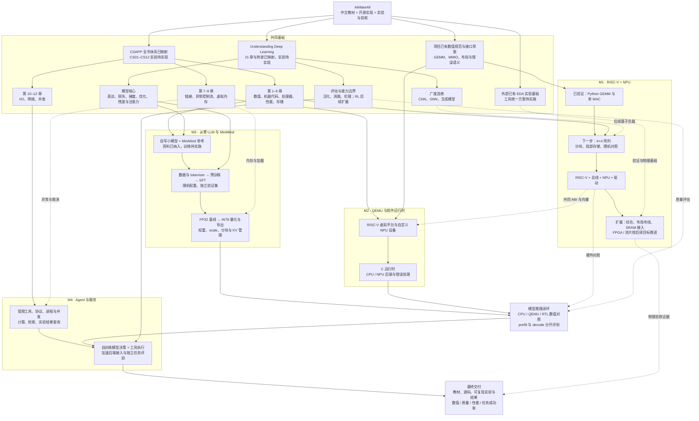

# AIMakeAll 全景规划图

更新：2026-11-17。状态以本项目记录为准；外部实验成果不等于已经接入本项目，资料规划不等于功能实现。

## 下一步与并行关系

1. 硬件推进 4×4 阵列，结合 CS02/CS04/CS06 学习数值、控制与存储。
2. 同期建立 C 构建追踪与 UDL 线性回归/小 MLP 实验，再进入自写 Transformer 与 MiniMind 小模型 CPU 环境；两套基础按需学习，不等待全书读完。
3. 围绕 GEMM/MMIO 接口逐步建立 QEMU 设备与运行时，再接量化模型。
4. 最后把模型推理接入受限 Agent，补文件、网络、并发和故障处理。

SRAM 与物理实现为扩展线，其状态需独立核验；早期功能实验可使用行为内存。QEMU 功能模拟、宿主机提速和真实硬件加速分开报告。

## 详细路线

- [CSAPP 全书知识体系与项目实验](CSAPP_FOUNDATIONS.md)
- [Understanding Deep Learning 知识体系与项目实验](UDL_FOUNDATIONS.md)
- [课程目录](CURRICULUM.md) · [里程碑](ROADMAP.md) · [系统架构](ARCHITECTURE.md)
- [本地 EDA 环境](LOCAL_EDA_ENVIRONMENT.md) · [工具统一方案](EDA_TOOLCHAIN_CONSOLIDATION.md)
- [MiniMind 学习与部署](MINIMIND_INTEGRATION.md)
